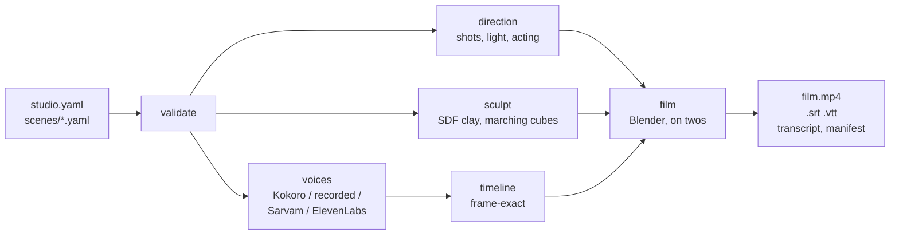

<p align="center">
  
</p>

<h1 align="center">Clayvoyant</h1>

<p align="center">
  <b>See the scam coming.</b><br>
  <b>Clay stop-motion films, written as plain text.</b><br>
  Describe the people, write what they say, choose where it happens.<br>
  The studio sculpts the cast, builds the set, lights it, films it and gives it a voice.
</p>

<p align="center">
  <a href="#make-a-film">Make a film</a> ·
  <a href="examples/the-fast-one/">The sample film</a> ·
  <a href="docs/INDIA.md">For India</a> ·
  <a href="docs/CLAY_MOTION.md">How the clay works</a> ·
  <a href="#documentation">Documentation</a> ·
  <a href="docs/ROADMAP.md">Roadmap</a>
</p>

<p align="center">
  <a href="https://xibbax.github.io/clayvoyant/"></a><br>
  <a href="https://xibbax.github.io/clayvoyant/"><b>Watch the whole film</b></a> (82 seconds) ·
  <a href="docs/SHOWCASE.md"><b>Before and after, frame by frame</b></a>
</p>

It began as a way to make security-awareness films: twelve short stories about phishing, passwords,
phone scams and reporting, in your organisation's name, words and language. It grew into a small
film studio. Every figure is sculpted from signed-distance clay and rigged with real hands and a
face that acts; every room is built by code; every shot is planned like a film and can be changed
in a line of YAML.

## Make a film

You need Python 3.11+, FFmpeg and [Blender](https://www.blender.org/download/) 4.2 or newer
([installing them](docs/INSTALLATION.md)). A GPU makes it quicker; it is not required.

```bash
git clone https://github.com/xIBBAx/clayvoyant
cd clayvoyant
python3 -m venv .venv && . .venv/bin/activate      # Windows: .venv\Scripts\activate
pip install -e ".[clay,voices]"

sastudio voices install kokoro                     # a free neural voice, downloaded once (350 MB)
sastudio film examples/the-fast-one --preset draft
```

That one command voices thirteen lines, sculpts three people, builds a cafe and an office, films
seventeen shots on twos and assembles a subtitled film in `examples/the-fast-one/build/`. No
account and no API key. Edit a line and only the shots it can affect are filmed again.
(`clayvoyant` works in place of `sastudio`: the project was called Security Awareness Studio until
November 2026.)

<p align="center">
  
</p>

**[Watch The Fast One](https://xibbax.github.io/clayvoyant/)**
(82 seconds, with subtitles). It is exactly what the command above makes with `--preset preview`:
seventeen filmed shots at 1280x720 and thirteen voiced lines, in 55 minutes on a laptop GeForce GTX
1660 Ti. Checked drawing by drawing, nothing in it passes through anything
([how](docs/CLAY_MOTION.md#nothing-passes-through-anything)).

Everything in [The Fast One](examples/the-fast-one/) comes from two scene files and one page of
character descriptions. Nobody opened Blender, drew anything or recorded a voice.

## What you direct

**People.** A character is a few lines: skin, hair, clothes, build, a face nudged wider or
sharper, and how they carry themselves. Ten hair styles, eight outfits, beards, glasses, a
headscarf, a bindi. No two characters share a face, even when described alike.

```yaml
  - id: bashir
    name: Bashir
    look:
      design:
        skin: "#8A5A3C"
        hair: { style: short, color: "#16110F" }
        outfit: { style: shirt, color: "#7FA3C4" }
        extras: [glasses, beard]
        body: { build: broad, height: tall }
        face: { jaw: 0.5, brows: 0.4 }
      acting: { energy: 0.8, posture: 0.6 }
```

<p align="center">
  
</p>

**Performances.** They walk on planted feet, sit down, turn to whoever is speaking, point, shrug,
fold their arms, type with their hands on the desk, carry a mug, read a phone. Mouths follow the
sounds of the words; eyes lead and the head follows; listeners react. What nobody wrote is acted
anyway, and what you write wins:

```yaml
  - id: fo_04
    who: odile
    go: table_left_2                 # walks over and takes the seat
    emotion: concern
    act: [hold_mug]
    reactions: { tara: worried }
    say: "Then somebody in here is fishing. And not for coffee."
```

**Places.** Office, reception, meeting room, home, cafe, corridor, street and classroom: built
by code, dressed in your organisation's colours and name, lit for morning, day, evening or night.
No model files, no photographs, nothing to license.

<p align="center">
  
</p>

**The camera.** Nine framings, seven moves, seven lighting moods, depth of field. Left alone, the
planner cuts like an editor: an answer gets a close-up, a question is seen over a shoulder, a long
line cuts away to the listener between two words, and no scene opens or ends the way the one before
it did. Every face gets room to look into, and no shot shows the back of a speaker's head.
`sastudio direct` prints the shot list before anything is filmed.

**Beginnings.** A scene opens on a filmed shot of its place with the title over it, entered the
way the story asks: a slow push into the room, a door that opens, the camera pulling back from an
object, a match cut on a face. Never a wipe.

**Voices.** [Kokoro](docs/VOICE_PROVIDERS.md#kokoro), a free neural voice that runs on your
computer, in British and American English and Hindi. Or your own recordings, one file per line.
Or Sarvam and ElevenLabs with your own key, a spending cap and a ledger; nothing paid ever runs
without `--live`. One film per language from the same project.

**Your own models.** A rigged glTF, FBX or OBJ character can join the cast with
`sastudio model import`; sculpted characters export to GLB, FBX, OBJ or `.blend`.

## The other renderer

The cards renderer needs no Blender and no GPU: the same scripts as a captioned film of drawn
characters who talk and blink, in three styles (sketch, flat, paper cut-out), fourteen minutes
rendered in about a minute.

```bash
sastudio init my-film --org "Riverside Public School" --email it-help@riverside-school.in --style v3
sastudio render my-film --preset draft
```

<p align="center">
  
</p>

## For India

Five everyday scams, each a short scene in English and Hindi, in your organisation's name:
"digital arrest" on a video call, a UPI request that wants your PIN, a caller who needs your OTP,
an electricity-bill message with an app to install, and a customer-care number from the top of a
search. Every line of advice follows an advisory from I4C, the RBI or the Department of
Telecommunications, and each scene names its source.

```bash
sastudio init my-film --template india --org "Sunrise Senior Citizens Forum" --email help@sunrise-forum.org
sastudio film my-film --preset draft --lang hi-IN
```

`sastudio posters my-film` prints each scene's lesson as an A4 poster, for a notice board.
`sastudio share my-film --each` makes one upright phone clip per scam, about a minute and 5 MB
each: small enough to forward. `--lang hi-Latn` gives the Hindi film with its words in Roman
letters, the way people type Hindi on a phone ("Papa, ek minute ke liye phone neeche rakhiye").

[Films for India](docs/INDIA.md) has the sources, nine more Indian languages and a checklist for
showing a film. [Nineteen Thirty](examples/nineteen-thirty/) is the first scene on its own, filmed
in clay.

## How it works



Acting is a pure function of the frame, so any shot can be filmed alone, shots of one scene always
agree, and a shot that stopped half way resumes at its first missing drawing. Sculpts, voices and
shots are cached by content. [ARCHITECTURE.md](docs/ARCHITECTURE.md) and
[CLAY_MOTION.md](docs/CLAY_MOTION.md) have the detail.

## What it costs to run

Measured on one laptop on 2026-11-11 (Intel Core i7-10750H, 12 threads, GeForce GTX 1660 Ti with
6 GB, Blender 5.2.2 under WSL2):

- Sculpting the sample's three characters: 46 seconds for all three, once per look.
- Voicing its thirteen lines with Kokoro on the CPU: 26 seconds for 47 seconds of speech.
- Filming at `preview` (1280x720): 4.7 seconds a drawing, about 2.3 minutes of work for each
  second of film on twos. `draft` (960x540) takes about half that. People the camera cannot see are
  not drawn.
- The cards renderer: the 14-minute starter film in 90 seconds at `preview` and 2 minutes 41 seconds
  at `final`, on the CPU.

## Known limits

- Kokoro has no Indian-English accent; English lines are read in a British or American voice.
- Imported models stand, walk, turn, look, talk and gesture; they do not sit or use hands.
- Lip sync follows the voice's phoneme timings when the provider reports them (Kokoro does), and
  otherwise the spelling and the loudness of the voice.
- There is no sound-effect or music library yet: a film has its dialogue and, if you add one, a
  music track. Rendering on a remote GPU is not built.
- Another language is another film: you write each line's translation in the scene file and
  render once per language. Nothing translates for you.
- The `final` preset (1920x1080) has not yet been run for a whole film; the sample was built with
  `preview`. CI has no Blender, so the clay smoke test runs only where Blender is installed.
- The starter scenes are general guidance, not policy. Replace each procedure with your own.
- On the sofa of the home set, a seated character still sinks into the cushion; Nineteen Thirty
  shows it ([#28](https://github.com/xIBBAx/clayvoyant/issues/28)).
- The `india` template's Hindi has not yet been reviewed by fluent speakers from its audience
  ([#20](https://github.com/xIBBAx/clayvoyant/issues/20)). Read every line aloud with someone who
  will watch it before you show it.

## Documentation

| Guide | |
|---|---|
| [Quickstart](docs/QUICKSTART.md) | a first film in ten minutes |
| [Why it exists](docs/WHY.md) | who it is for, what it costs, how it compares |
| [Films for India](docs/INDIA.md) | the `india` template, its sources, Indian languages |
| [Writing with an assistant](docs/WRITING_WITH_AN_ASSISTANT.md) | `sastudio brief`: a script from any chat assistant |
| [Installation](docs/INSTALLATION.md) and [requirements](docs/REQUIREMENTS.md) | Ubuntu, WSL2, Windows, Blender, GPUs |
| [Clay films](docs/CLAY_MOTION.md) | the engine: sculpting, acting, sets, light, caching |
| [Characters](docs/CHARACTERS.md) | describing people; every choice and slider |
| [Direction](docs/DIRECTION.md) | sets, marks, cameras, light, gestures, openings |
| [Scenes](docs/SCENES.md) and [configuration](docs/CONFIGURATION.md) | writing scenes, tokens, translations |
| [Voice providers](docs/VOICE_PROVIDERS.md) and [API keys](docs/API_SETUP.md) | Kokoro, recordings, Sarvam, ElevenLabs |
| [Rendering](docs/RENDERING.md) | presets, outputs, subtitles, incremental builds |
| [Architecture](docs/ARCHITECTURE.md) and [glossary](docs/GLOSSARY.md) | how it fits together |
| [Troubleshooting](docs/TROUBLESHOOTING.md) | common errors and their fixes |
| [Roadmap](docs/ROADMAP.md) and [testing](docs/TESTING.md) | what comes next; how it is checked |

## Responsible use

Never clone a real person's voice or use their likeness without written consent. A film does not
make an organisation compliant with any standard. Models, sounds and images you bring must be
yours to use; the studio records the licence you give for each imported model.

## Contributing

Sets, garments, hair, gestures, scene templates, translations, voice adapters, fixes and
documentation are welcome. [CONTRIBUTING.md](CONTRIBUTING.md) explains how changes are tested and
how secrets and unlicensed material are kept out. Please follow the
[code of conduct](CODE_OF_CONDUCT.md) and report vulnerabilities privately ([SECURITY.md](SECURITY.md)).
Working with a coding assistant? [AGENTS.md](AGENTS.md) tells it how to make a film here and what
never to do.

## License

Code, sculpts, sets and sample scripts: [MIT](LICENSE). Bundled fonts: SIL Open Font License.
Every bundled file is listed in [ASSET_LICENSES.md](ASSET_LICENSES.md). Optional voice software
keeps its own licences ([details](docs/VOICE_PROVIDERS.md#kokoro)). Films you make are yours, and
you do not need to credit this project in them.
