<p align="center">
  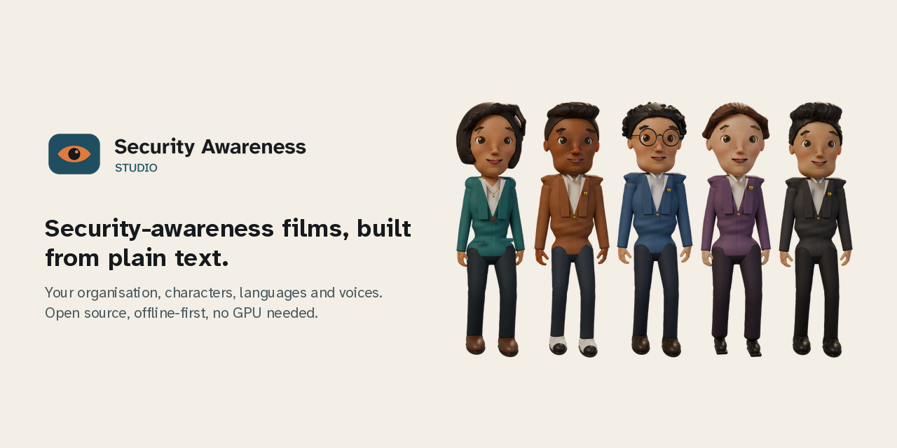
</p>

# Security Awareness Studio

An open-source framework for making captioned information-security awareness films, with your own
organisation, characters, languages, voices and branding.

You describe the film in plain text files: your organisation's name, colours and reporting address,
a cast of characters, and short scenes of dialogue. One command turns them into a captioned training
film, with subtitles, a transcript and a checksummed manifest. It runs on an ordinary computer with
no GPU and no account. Real voices from Sarvam or ElevenLabs are optional, use your own account, and
never cost anything unless you ask for them.


[Quickstart](docs/QUICKSTART.md) ·
[Documentation](#documentation) ·
[Reference films](#the-reference-film) ·
[Worked example](examples/quillmere/)

## The reference film

<p align="center">
  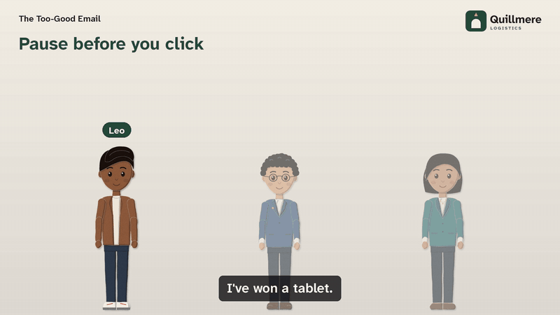
</p>

The 12-scene starter film, **Security Awareness in Twelve Stories** (14 min 23 s,
1920 x 1080), was rendered by this tool from the starter template with one fictional
organisation's branding, Quillmere Logistics. It covers phishing, passwords and MFA, phone
impersonation, payment fraud, clear desk and tailgating, removable media, remote work, data
handling, AI tools and incident reporting.

The film, its SRT and WebVTT subtitles, an 83-second trailer and the worked example in English and
Hindi are attached to the [v0.1.0 release](https://github.com/xIBBAx/security-awareness-studio/releases/tag/v0.1.0)
with SHA-256 checksums. How each one was checked is in
[docs/media/film/VERIFY.md](docs/media/film/VERIFY.md).

What you see is what this release makes: illustrated cards with hard cuts between them, a still
portrait of whoever is speaking, and every line in large on-screen text. The characters are not
animated. The voices in these films are the free offline placeholder, which is silent; the dialogue
is in the subtitles. A film made with Sarvam or ElevenLabs voices uses your own account.

<p>
  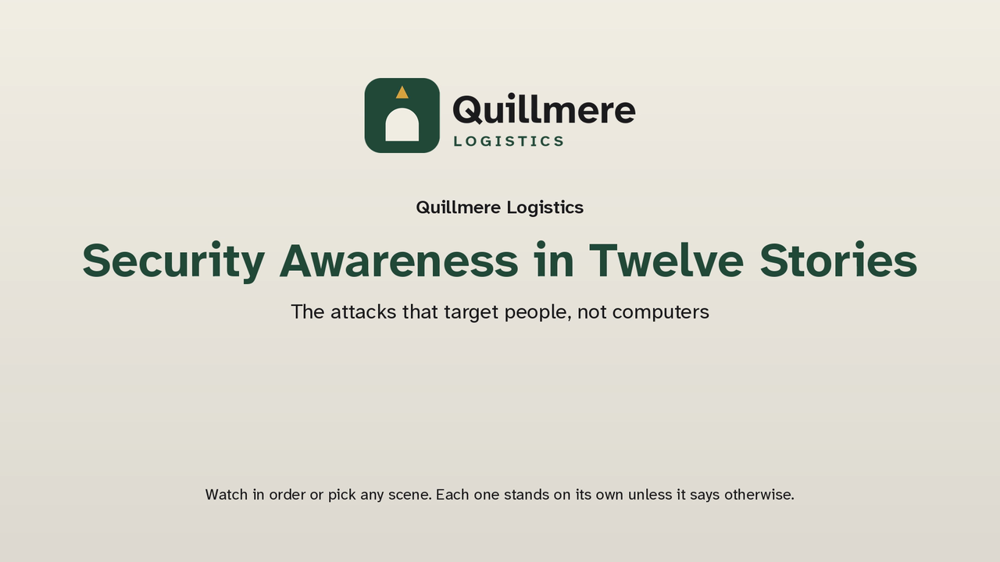
  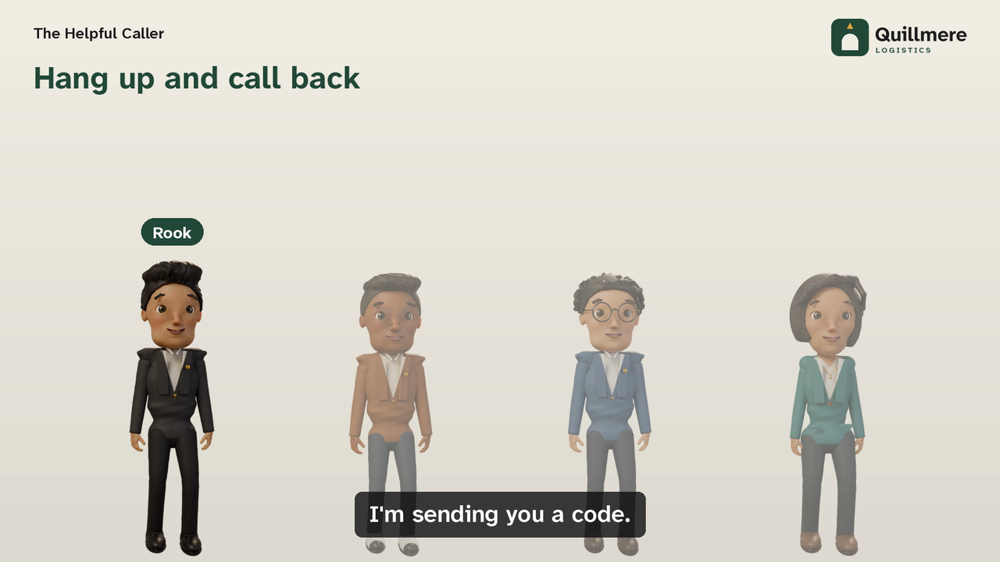
  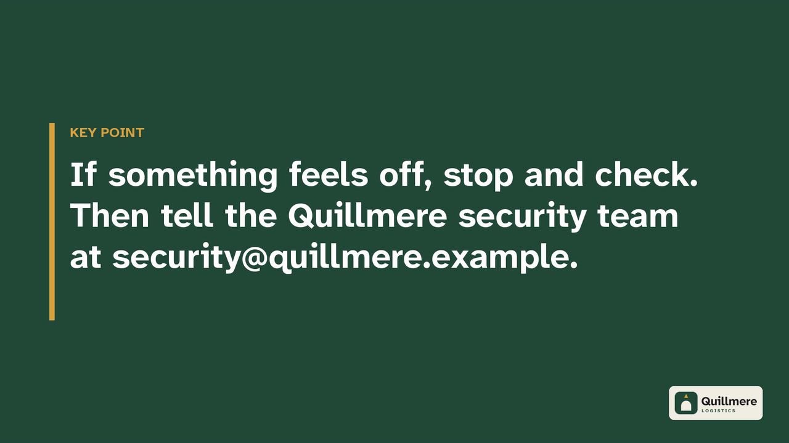
  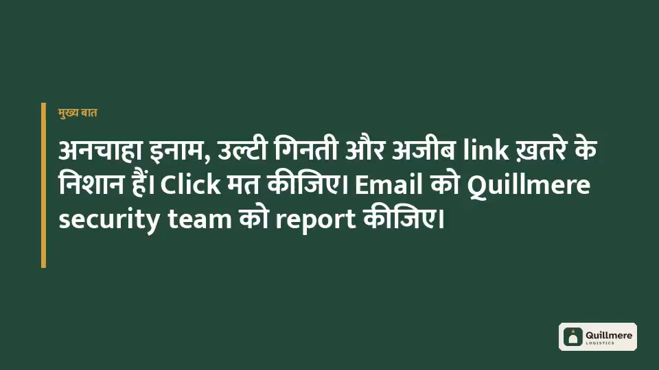
</p>

## Meet the characters

Five clay-style characters, designed for this project, come with the starter project. Their names, pronouns, voices,
spoken names and dialogue are all set in your project file; their ids stay the same, so renaming
one never breaks a scene.

| | Character |
|---|---|
|  | **Mira** · `mira` · Security lead<br>Calm, dry and quick. Has seen every trick and is still kind about it. |
| 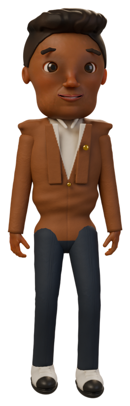 | **Leo** · `leo` · New starter<br>Enthusiastic, generous, a little too trusting. Learns fast. |
|  | **Aarav** · `aarav` · Finance<br>Careful, deadpan, notices the one detail that is wrong. |
|  | **Nadia** · `nadia` · Operations manager<br>Busy, brisk, protective of her team. Nobody rushes her twice. |
|  | **Rook** · `rook` · The impersonator<br>Charming, patient, never who they say they are. Turns up as a courier, a caller, a "boss". |

You can rename any of them, change their pronouns and voices, remove them, or add your own
characters with any portrait image. Changing their 3D appearance needs the clay renderer, which is
not part of this release ([CHARACTERS.md](docs/CHARACTERS.md)).

## What it does

| | In 0.1 |
|---|---|
| **Your organisation** | Name, short name, logo, colours, security reporting email and URL, team names, your own words for "colleagues" or "laptop", an announcement on the title card. Set once, used everywhere. |
| **Characters** | Stable ids with display names, spoken names, pronouns, gendered grammar, per-language names and provider-specific pronunciation hints. |
| **Scenes** | YAML scenes of dialogue and on-screen cards, turned on or off, with dependency checks between scenes, key-point cards, policy notes and time limits. |
| **Languages** | One film per language from the same project. English and Hindi samples included; Sarvam's catalogue lists English (India) and ten Indian languages. |
| **Voices** | Sarvam (Bulbul v2, v3, v4-flash), ElevenLabs (v2 to v4 and Flash models) and a free offline placeholder. Content-addressed cache, character budgets, retries, rate limits and a request ledger. |
| **Video** | The cards renderer: still character portraits on illustrated cards, with hard cuts; 960x540, 1280x720 or 1920x1080 at 24 fps, H.264 and AAC. Only changed scenes are rendered again. |
| **Accessibility** | SRT and WebVTT subtitles with speaker tags, optional burned-in subtitles, transcripts, Devanagari text shaping, colour-contrast checks, no flashing effects. |
| **Checks** | `validate` before rendering; every finished film is checked with `ffprobe` for frame count and audio length; a manifest records checksums. |
| **Not in 0.1** | The clay renderer (animated 3D puppets), live-tested provider integrations, a graphical editor. See the [roadmap](docs/ROADMAP.md). |

## How it works

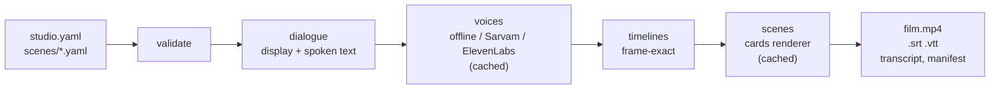

Details: [ARCHITECTURE.md](docs/ARCHITECTURE.md).

## Install

You need Python 3.11 or newer and FFmpeg ([installation guide](docs/INSTALLATION.md) for Ubuntu,
WSL2 and Windows).

```bash
git clone https://github.com/xIBBAx/security-awareness-studio
cd security-awareness-studio
python3 -m venv .venv
. .venv/bin/activate              # Windows: .venv\Scripts\activate
pip install -e .
sastudio doctor                   # checks everything and says how to fix what is missing
```

## Your first film

```bash
sastudio init my-film                     # copy the 12-scene starter project
sastudio validate my-film
sastudio render my-film --preset draft    # about a minute; no account, no GPU
```

The film, subtitles, transcript and manifest are in `my-film/build/en-IN/`. Then make it yours:

## Make it yours

Every change below is a text edit; no code. The complete version of this walkthrough, with every
change marked, is [examples/quillmere](examples/quillmere/), which renders in English and Hindi.

**Your organisation, email and logo** (`studio.yaml`):

```yaml
organization:
  name: "Quillmere Logistics"
  security_email: "security@quillmere.example"    # shown and spoken wherever a scene says {org.security_email}
  reporting_url: "https://quillmere.example/report"
  security_team: "the Quillmere security team"
  logo: assets/logo.png                           # replace the file with your own logo
  palette: { primary: "#23493B", accent: "#D9A441", background: "#F3EFE6", text: "#1C1C1E" }
```

**A character's name and how it is said.** The id `leo` stays, so every scene keeps working:

```yaml
  - id: leo
    name: Kabir                          # was Leo; subtitles, labels and transcripts follow
    spoken: { hi-IN: "कबीर" }             # what Hindi voices say
    pronunciation:
      elevenlabs: { alias: "Kuh-beer" }  # a hint sent only to ElevenLabs
```

**A character's voice.** Offline is free; a paid voice needs your own key ([API_SETUP.md](docs/API_SETUP.md)):

```yaml
    voice: { provider: sarvam, model: "bulbul:v3", speaker: "rahul" }
```

From then on `render` stops with exit code 7 and lists that character's lines until you generate
them (`sastudio voices generate my-film --live --max-characters N`, paid). To keep previewing for
free, add `--voice-fallback offline`: those lines use the placeholder voice, clearly labelled.

**A line of dialogue** (`scenes/11_report_early.yaml`). Names and addresses are tokens, never typed out:

```yaml
  - id: re_10
    who: mira
    say: "Especially then. Write to {org.security_email}, or use the form at {org.reporting_url}."
```

**Languages and output** (`studio.yaml`):

```yaml
project:
  languages: [en-IN, hi-IN]     # one film per language; every line needs a translation
render:
  preset: final                 # 1920x1080
  subtitle_speaker_labels: true
```

The 12-scene starter is written in English only, so adding `hi-IN` makes `validate` list every line
that still needs Hindi text. The 3-scene `short` template ships both languages (see Rendering).

Then check what will be shown and said, and what it will cost, before rendering:

```bash
sastudio validate my-film
sastudio script my-film --scenes report_early     # display text and the exact text each voice receives
sastudio voices plan my-film                      # characters per provider; prices only if you add them
```

## Rendering

```bash
sastudio render my-film --preset draft                          # quick check, 960x540
sastudio render my-film --scenes too_good_email --preset preview # one scene, 1280x720
sastudio render my-film --preset final                          # the whole film, 1920x1080
```

If any character uses Sarvam or ElevenLabs and their lines are not generated yet, add
`--voice-fallback offline` to any of these, or `render` stops and lists the missing lines.

Another language needs a translation of every line. The `short` template ships English and Hindi:

```bash
sastudio init my-short --template short
sastudio render my-short --lang hi-IN --preset draft   # Devanagari subtitles and cards
```

Only scenes whose content changed are rendered again. Presets, subtitles, music and output files
are described in [RENDERING.md](docs/RENDERING.md).

## Screenshots

Real command output from a fresh starter project, drawn as images by
[`tools/make_screenshots.py`](tools/make_screenshots.py).

<p>
  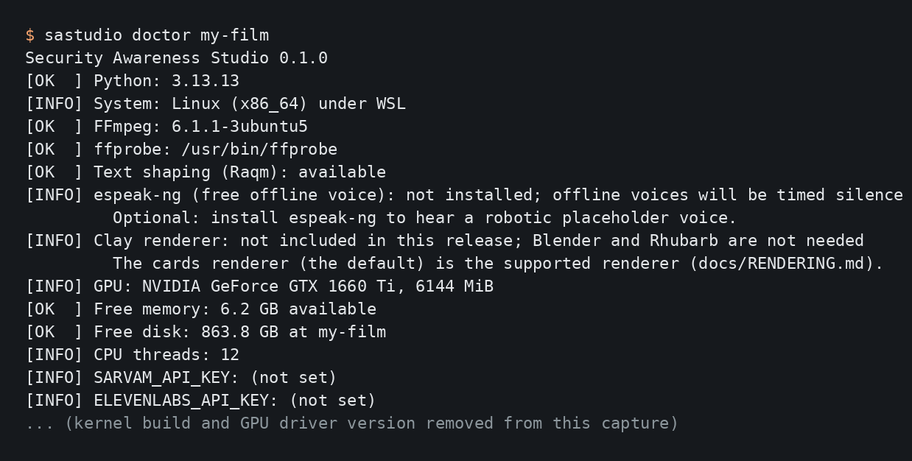
  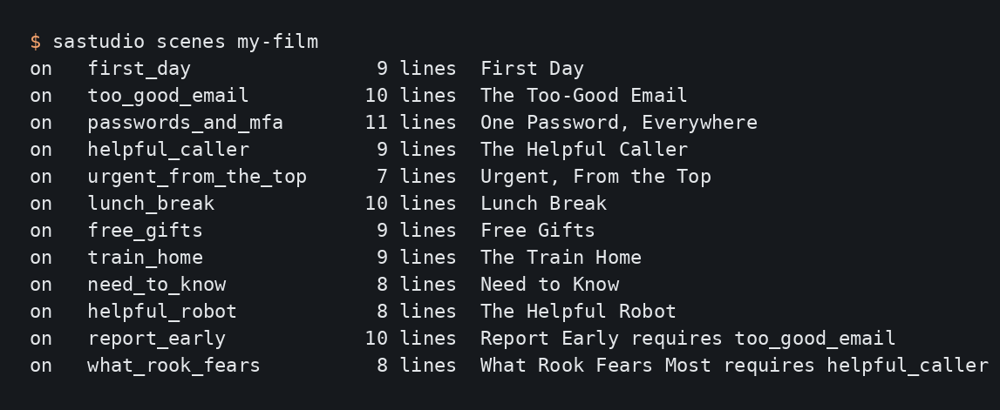
</p>

Left: `sastudio doctor` checks the computer. Right: `sastudio scenes` lists scenes and dependencies.

<p>
  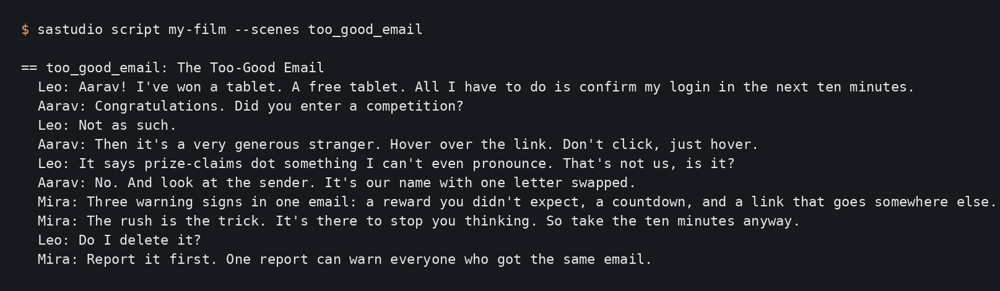
  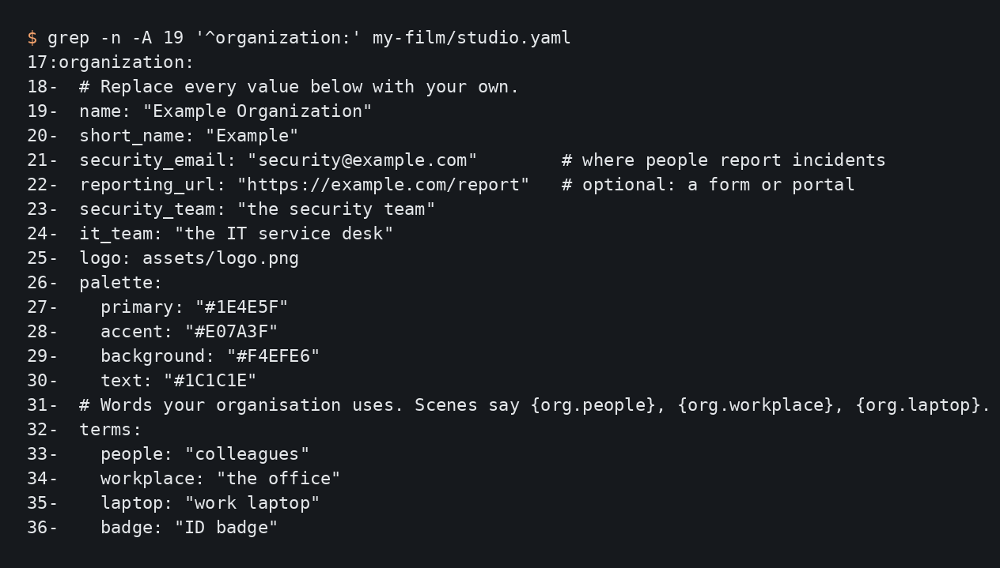
</p>

Left: `sastudio script` shows what will be said. Right: The organisation block of `studio.yaml`.

<p>
  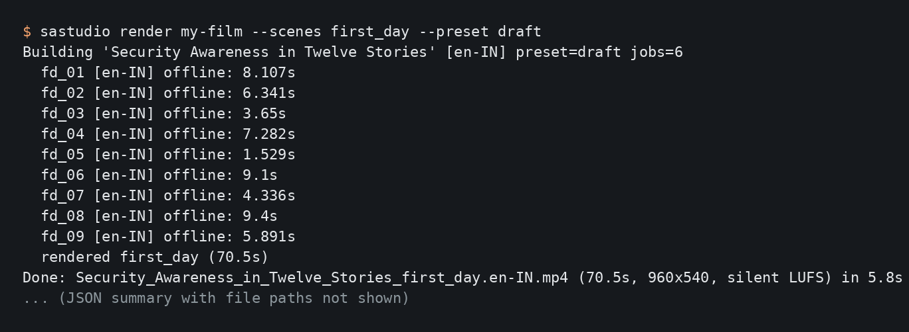
  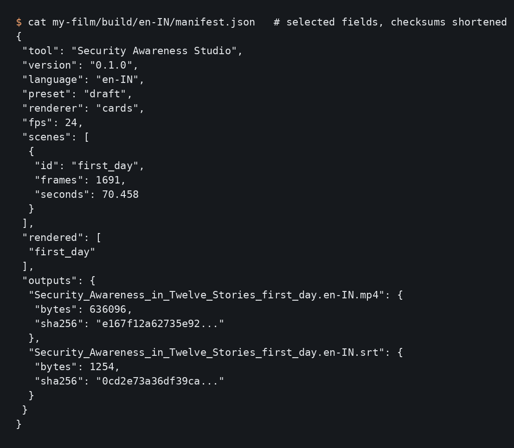
</p>

Left: Rendering one scene. Right: The manifest records what was built.

## Hardware

| | |
|---|---|
| **Minimum** | Any 64-bit computer that runs Python 3.11+ and FFmpeg with libx264; about 1 GB of free memory; no GPU. |
| **Tested** | Intel Core i7-10750H (12 threads), 7.7 GB of memory for WSL2, Ubuntu 24.04: the whole 14-minute starter film in 74 s at 1280x720 (237 MB peak memory) and 2 min 22 s at 1920x1080 (615 MB). |
| **Faster** | More CPU threads: scenes render in parallel (`--jobs`). A GPU does not speed up the cards renderer. |

These are measurements on one machine, not promises ([REQUIREMENTS.md](docs/REQUIREMENTS.md)).

## Costs

| | Cost |
|---|---|
| Installing, validating, rendering with offline voices, the test suite | free, offline |
| Sarvam or ElevenLabs voices | charged by the provider to your own account, per character |

Paid requests happen only with `--live` **and** a character budget above zero, which is `0` in every
template. Generated lines are cached and never requested twice. The project ships no prices;
`sastudio voices plan` estimates cost from a price table you copy from your provider
([VOICE_PROVIDERS.md](docs/VOICE_PROVIDERS.md#estimating-cost)).

## Documentation

| Guide | |
|---|---|
| [Quickstart](docs/QUICKSTART.md) | your first film in ten minutes |
| [Installation](docs/INSTALLATION.md) and [requirements](docs/REQUIREMENTS.md) | Ubuntu, WSL2, Windows; measured performance |
| [Configuration](docs/CONFIGURATION.md) | `studio.yaml`: organisation, characters, labels, paths |
| [Scenes](docs/SCENES.md) | writing scenes, tokens, translations, dependencies |
| [Characters](docs/CHARACTERS.md) | the cast and what you can change |
| [Voice providers](docs/VOICE_PROVIDERS.md) and [API keys](docs/API_SETUP.md) | offline, Sarvam, ElevenLabs, budgets, pronunciation |
| [Rendering](docs/RENDERING.md) | presets, outputs, subtitles, incremental builds |
| [Architecture](docs/ARCHITECTURE.md) and [glossary](docs/GLOSSARY.md) | how it fits together; terms explained |
| [Troubleshooting](docs/TROUBLESHOOTING.md) | common errors and their fixes |
| [Roadmap](docs/ROADMAP.md) | what is done and what could come next |
| [Testing](docs/TESTING.md) | how to run the tests, and every edge case with its status |

## Use it responsibly

The starter scenes are general awareness material, not policy. Replace every procedure with your
organisation's real one before you show a film to anyone; scenes mark the lines that most need this
with `policy_note`. A film made with this tool does not make an organisation compliant with any
standard. Never clone a real person's voice, or use their likeness, without their written consent.

## Contributing

Scene templates, translations, voice-provider adapters, fixes and documentation are welcome. Read
[CONTRIBUTING.md](CONTRIBUTING.md) first: it explains the rules that keep secrets, confidential
material and unlicensed content out of the project. Please follow the
[code of conduct](CODE_OF_CONDUCT.md), and report vulnerabilities privately as described in
[SECURITY.md](SECURITY.md).

## License

The code is under the [MIT License](LICENSE). The media made for this project (characters,
portraits, logos, sample scripts) are shared under the same licence, and the bundled fonts under the SIL Open Font
License; every file is listed in [ASSET_LICENSES.md](ASSET_LICENSES.md). Films you make are yours,
and you don't need to credit this project in them. Speech you generate is governed by your voice
provider's terms.

## Author

Created and maintained by **Ibrahim Sultan**.
