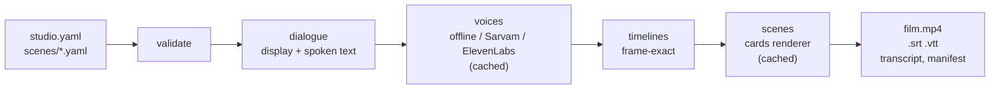

<p align="center">
  
</p>

<h1 align="center">Security Awareness Studio</h1>

<p align="center">
  <b>Security-awareness training films in your organisation's words, voices and language,<br>
  made from a few text files on an ordinary laptop.</b>
</p>

<p align="center">
  <a href="docs/QUICKSTART.md">Quickstart</a> ·
  <a href="#documentation">Documentation</a> ·
  <a href="examples/quillmere/">Worked example</a> ·
  <a href="https://github.com/xIBBAx/security-awareness-studio/releases/latest">Sample films</a> ·
  <a href="docs/ROADMAP.md">Roadmap</a>
</p>

<p align="center">
  
</p>

Most security training is generic, expensive or both. This tool turns twelve short, practical
stories about phishing, passwords and MFA, phone scams, payment fraud, tailgating, removable media,
remote work, data handling, AI tools and reporting into a captioned film that uses your
organisation's name, reporting address, characters and language. Edit a sentence and only that
scene renders again.

## Make your first film

You need Python 3.11+ and FFmpeg ([installing them](docs/INSTALLATION.md)).

```bash
git clone https://github.com/xIBBAx/security-awareness-studio
cd security-awareness-studio
python3 -m venv .venv && . .venv/bin/activate      # Windows: .venv\Scripts\activate
pip install -e .

sastudio init my-film --org "Riverside Public School" \
    --email it-help@riverside-school.in --style v3
sastudio render my-film --preset draft
```

A 14-minute film with subtitles, a transcript and a checksummed manifest appears in
`my-film/build/en-IN/`, in about a minute. No GPU, no account, no API key: on a clean machine,
these steps plus `sastudio doctor` and `sastudio validate` took 8 commands and about 64 seconds.

## What you get

- **Your organisation, everywhere.** Name, logo, colours, reporting email and form, team names and your own words for "colleagues" or "laptop". Set once; every scene, card and subtitle follows.
- **Characters in four styles.** Sketch, flat and paper cut-out figures drawn by the tool, whose speaker talks and blinks, or still clay portraits. Rename anyone, or describe a new person in a few words.
- **Your language.** One film per language from the same project. English and Hindi are included, with Devanagari shaping and per-language names.
- **Voices, never by surprise.** A free offline voice, or Sarvam and ElevenLabs with your own key, a spending cap and a request ledger. Nothing paid runs without `--live`.
- **Accessible output.** Burned-in and separate subtitles (SRT, WebVTT) with speaker names, transcripts and colour-contrast checks.
- **Safe to share.** A final film refuses a placeholder reporting address; every output is checksummed; project files can never run code.

## Characters

<p align="center">
  
</p>

Choose a style for the whole film (`--style v1` to `v4`) or per character, and preview the cast
before rendering with `sastudio characters my-film --sheet cast.png`. A new character is a few lines
of text, with no drawing:

```yaml
  - id: priya
    name: Priya
    role: Branch manager
    look:
      design:
        skin: "#A8704C"
        hair: { style: bun, color: "#16100E" }
        outfit: { style: kurta, color: "#8E2F4B" }
        extras: [bindi, earrings]
```

Ten hair styles (including a headscarf), six outfits (including a kurta) and extras such as glasses,
a beard or a bindi. See [CHARACTERS.md](docs/CHARACTERS.md).

## Make it yours

Everything is a text edit; no code. Rename a character in one place and every subtitle and spoken
line follows:

```yaml
  - id: leo
    name: Kabir                          # subtitles, labels and transcripts follow
    spoken: { hi-IN: "कबीर" }             # what Hindi voices say
```

Rewrite a line, keeping names and addresses as tokens:

```yaml
  - id: re_10
    who: mira
    say: "Especially then. Write to {org.security_email}, or use the form at {org.reporting_url}."
```

Then check what will be shown and said, and what a paid voice would cost, before rendering:

```bash
sastudio validate my-film
sastudio script my-film --scenes report_early
sastudio voices plan my-film
```

The full walkthrough, with every change marked, is [examples/quillmere](examples/quillmere/).

## How it works



Every stage is cached by content, so changing one line re-voices and re-renders only what that line
touches. Details: [ARCHITECTURE.md](docs/ARCHITECTURE.md).

## Requirements

- **Needed.** Python 3.11+, FFmpeg with libx264, about 1 GB of free memory. Tested on Ubuntu and Windows (in CI) and on WSL2.
- **Optional.** espeak-ng for an audible free voice; a Sarvam or ElevenLabs account for natural voices.
- **Measured.** Intel Core i7-10750H, 12 threads: the 14-minute film in 51-60 s as a draft and about 2 min 20 s at 1920x1080. A GPU is not used by the cards renderer.

## Status

Released: everything above. In development: clay stop-motion with acting characters, staged
cameras and lighting, your own 3D models, sound effects and visual effects
([design and progress](docs/CLAY_MOTION.md)). Planned features are never described as working until
they render and are tested.

## Documentation

| Guide | |
|---|---|
| [Quickstart](docs/QUICKSTART.md) | your first film in ten minutes |
| [Installation](docs/INSTALLATION.md) and [requirements](docs/REQUIREMENTS.md) | Ubuntu, WSL2, Windows; measured performance |
| [Configuration](docs/CONFIGURATION.md) | `studio.yaml`: organisation, characters, labels, paths |
| [Scenes](docs/SCENES.md) | writing scenes, tokens, translations, dependencies |
| [Characters](docs/CHARACTERS.md) | styles, designs and what you can change |
| [Voice providers](docs/VOICE_PROVIDERS.md) and [API keys](docs/API_SETUP.md) | offline, Sarvam, ElevenLabs, budgets, pronunciation |
| [Rendering](docs/RENDERING.md) | presets, outputs, subtitles, incremental builds |
| [Architecture](docs/ARCHITECTURE.md) and [glossary](docs/GLOSSARY.md) | how it fits together |
| [Troubleshooting](docs/TROUBLESHOOTING.md) | common errors and their fixes |
| [Roadmap](docs/ROADMAP.md) and [clay motion](docs/CLAY_MOTION.md) | what comes next |
| [Testing](docs/TESTING.md) | how to run the tests, and every edge case with its status |

## Responsible use

The starter scenes are general guidance, not policy: replace each procedure with your
organisation's real one (scenes mark them with `policy_note`). A film does not make an
organisation compliant with any standard. Never clone a real person's voice or use their likeness
without written consent.

## Contributing

Scene templates, translations, characters, voice adapters, fixes and documentation are welcome.
[CONTRIBUTING.md](CONTRIBUTING.md) explains how changes are tested and how secrets, confidential
material and unlicensed content are kept out. Please follow the [code of conduct](CODE_OF_CONDUCT.md)
and report vulnerabilities privately ([SECURITY.md](SECURITY.md)).

## License

Code: [MIT](LICENSE). Media made for this project (characters, portraits, the drawn styles, logos,
sample scripts): MIT. Bundled fonts: SIL Open Font License. Every file is listed in
[ASSET_LICENSES.md](ASSET_LICENSES.md). Films you make are yours, and you don't need to credit this
project in them.
