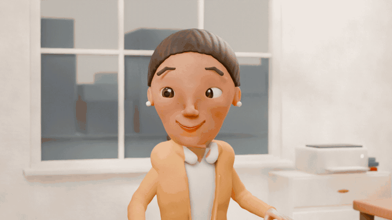
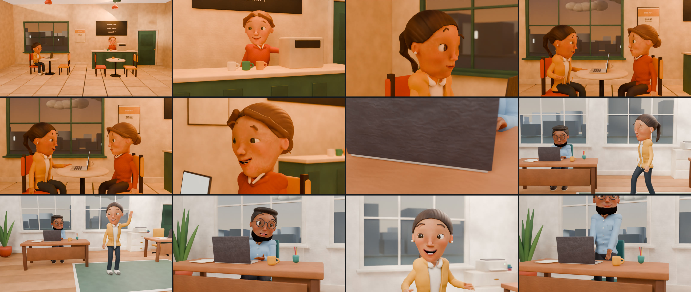
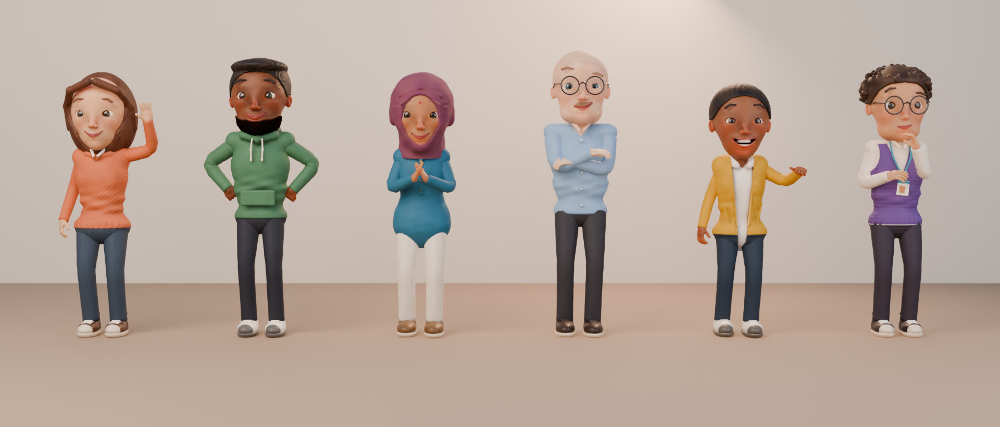
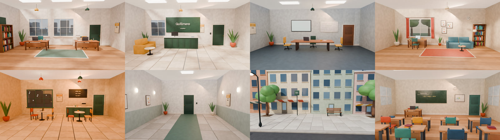
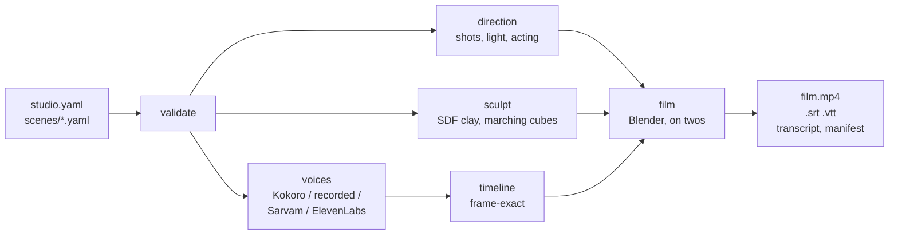

<p align="center">
  
</p>

<h1 align="center">Security Awareness Studio</h1>

<p align="center">
  <b>Clay stop-motion films, written as plain text.</b><br>
  Describe the people, write what they say, choose where it happens.<br>
  The studio sculpts the cast, builds the set, lights it, films it and gives it a voice.
</p>

<p align="center">
  <a href="#make-a-film">Make a film</a> ·
  <a href="examples/the-fast-one/">The sample film</a> ·
  <a href="docs/CLAY_MOTION.md">How the clay works</a> ·
  <a href="#documentation">Documentation</a> ·
  <a href="docs/ROADMAP.md">Roadmap</a>
</p>

<p align="center">
  
</p>

It began as a tool for security-awareness training, and it still makes that better than anything
else here: twelve practical stories about phishing, passwords, phone scams and reporting, in your
organisation's name, words and language. But what it has grown into is a small film studio. Every
figure is sculpted from signed-distance clay and rigged with real hands and a face that acts; every
room is built by code; every shot is planned like a film and can be changed in a line of YAML.

## Make a film

You need Python 3.11+, FFmpeg and [Blender](https://www.blender.org/download/) 4.2 or newer
([installing them](docs/INSTALLATION.md)). A GPU makes it quicker; it is not required.

```bash
git clone https://github.com/xIBBAx/security-awareness-studio
cd security-awareness-studio
python3 -m venv .venv && . .venv/bin/activate      # Windows: .venv\Scripts\activate
pip install -e ".[clay,voices]"

sastudio voices install kokoro                     # a free neural voice, downloaded once (350 MB)
sastudio film examples/the-fast-one --preset draft
```

That one command voices thirteen lines, sculpts three people, builds a cafe and an office, films
fourteen shots on twos and assembles a subtitled film in `examples/the-fast-one/build/`. No
account and no API key. Edit a line and only the shots it can affect are filmed again.

<p align="center">
  
</p>

Everything in [The Fast One](examples/the-fast-one/) comes from two scene files and one page of
character descriptions. Nobody opened Blender, drew anything or recorded a voice.

## What you direct

**People.** A character is a few lines: skin, hair, clothes, build, a face nudged wider or
sharper, and how they carry themselves. Ten hair styles, eight outfits, beards, glasses, a
headscarf, a bindi. No two characters share a face, even when described alike.

```yaml
  - id: bashir
    name: Bashir
    look:
      design:
        skin: "#8A5A3C"
        hair: { style: short, color: "#16110F" }
        outfit: { style: shirt, color: "#7FA3C4" }
        extras: [glasses, beard]
        body: { build: broad, height: tall }
        face: { jaw: 0.5, brows: 0.4 }
      acting: { energy: 0.8, posture: 0.6 }
```

<p align="center">
  
</p>

**Performances.** They walk on planted feet, sit down, turn to whoever is speaking, point, shrug,
fold their arms, type with their hands on the desk, carry a mug, read a phone. Mouths follow the
sounds of the words; eyes lead and the head follows; listeners react. What nobody wrote is acted
anyway, and what you write wins:

```yaml
  - id: fo_04
    who: odile
    go: table_left_2                 # walks over and takes the seat
    emotion: concern
    act: [hold_mug]
    reactions: { tara: worried }
    say: "Then somebody in here is fishing. And not for coffee."
```

**Places.** Office, reception, meeting room, home, cafe, corridor, street and classroom: built
by code, dressed in your organisation's colours and name, lit for morning, day, evening or night.
No model files, no photographs, nothing to license.

<p align="center">
  
</p>

**The camera.** Nine framings, seven moves, seven lighting moods, depth of field. Left alone, the
planner cuts like an editor: an answer gets a close-up, a question is seen over a shoulder, a
scene's last word pushes in, and no scene opens the way the last one did. `sastudio direct` prints
the shot list before anything is filmed.

**Beginnings.** A scene opens on a filmed shot of its place with the title over it, entered the
way the story asks: a slow push into the room, a door that opens, the camera pulling back from an
object, a match cut on a face. Never a wipe.

**Voices.** [Kokoro](docs/VOICE_PROVIDERS.md#kokoro), a free neural voice that runs on your
computer, in British and American English and Hindi. Or your own recordings, one file per line.
Or Sarvam and ElevenLabs with your own key, a spending cap and a ledger; nothing paid ever runs
without `--live`. One film per language from the same project.

**Your own models.** A rigged glTF, FBX or OBJ character can join the cast with
`sastudio model import`; sculpted characters export to GLB, FBX, OBJ or `.blend`.

## The other renderer

The cards renderer needs no Blender and no GPU: the same scripts as a captioned film of drawn
characters who talk and blink, in three styles (sketch, flat, paper cut-out), fourteen minutes
rendered in about a minute.

```bash
sastudio init my-film --org "Riverside Public School" --email it-help@riverside-school.in --style v3
sastudio render my-film --preset draft
```

<p align="center">
  
</p>

## How it works



Acting is a pure function of the frame, so any shot can be filmed alone, shots of one scene always
agree, and a shot that stopped half way resumes at its first missing drawing. Sculpts, voices and
shots are cached by content. [ARCHITECTURE.md](docs/ARCHITECTURE.md) and
[CLAY_MOTION.md](docs/CLAY_MOTION.md) have the detail.

## What it costs to run

Measured on one laptop (Intel Core i7-10750H, 12 threads, GeForce GTX 1660 Ti with 6 GB, Blender
5.2 under WSL2):

- Sculpting a character: about 25 seconds, once per look.
- A voice line with Kokoro: about half its own length, on the CPU.
- Filming: 2 to 3 seconds per drawing at 960x540, so roughly half a minute of work for each second
  of film on twos. People the camera cannot see are not drawn.
- The cards renderer: the 14-minute starter film in about a minute as a draft.

## Honest edges

- Kokoro has no Indian-English accent; English lines are read in a British or American voice.
- Imported models stand, walk, turn, look, talk and gesture; they do not sit or use hands.
- Lip sync follows the provider's phoneme timings when it reports them (Kokoro does), and
  otherwise the spelling and the loudness of the voice.
- There is no sound-effect or music library yet: a film has its dialogue and, if you add one, a
  music track. Rendering on a remote GPU is not built.
- The starter scenes are general guidance, not policy. Replace each procedure with your own.

## Documentation

| Guide | |
|---|---|
| [Quickstart](docs/QUICKSTART.md) | a first film in ten minutes |
| [Installation](docs/INSTALLATION.md) and [requirements](docs/REQUIREMENTS.md) | Ubuntu, WSL2, Windows, Blender, GPUs |
| [Clay films](docs/CLAY_MOTION.md) | the engine: sculpting, acting, sets, light, caching |
| [Characters](docs/CHARACTERS.md) | describing people; every choice and slider |
| [Direction](docs/DIRECTION.md) | sets, marks, cameras, light, gestures, openings |
| [Scenes](docs/SCENES.md) and [configuration](docs/CONFIGURATION.md) | writing scenes, tokens, translations |
| [Voice providers](docs/VOICE_PROVIDERS.md) and [API keys](docs/API_SETUP.md) | Kokoro, recordings, Sarvam, ElevenLabs |
| [Rendering](docs/RENDERING.md) | presets, outputs, subtitles, incremental builds |
| [Architecture](docs/ARCHITECTURE.md) and [glossary](docs/GLOSSARY.md) | how it fits together |
| [Troubleshooting](docs/TROUBLESHOOTING.md) | common errors and their fixes |
| [Roadmap](docs/ROADMAP.md) and [testing](docs/TESTING.md) | what comes next; how it is checked |

## Responsible use

Never clone a real person's voice or use their likeness without written consent. A film does not
make an organisation compliant with any standard. Models, sounds and images you bring must be
yours to use; the studio records the licence you give for each imported model.

## Contributing

Sets, garments, hair, gestures, scene templates, translations, voice adapters, fixes and
documentation are welcome. [CONTRIBUTING.md](CONTRIBUTING.md) explains how changes are tested and
how secrets and unlicensed material are kept out. Please follow the
[code of conduct](CODE_OF_CONDUCT.md) and report vulnerabilities privately ([SECURITY.md](SECURITY.md)).

## License

Code, sculpts, sets and sample scripts: [MIT](LICENSE). Bundled fonts: SIL Open Font License.
Every bundled file is listed in [ASSET_LICENSES.md](ASSET_LICENSES.md). Optional voice software
keeps its own licences ([details](docs/VOICE_PROVIDERS.md#kokoro)). Films you make are yours, and
you do not need to credit this project in them.
