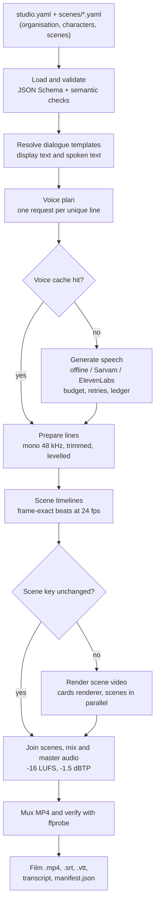
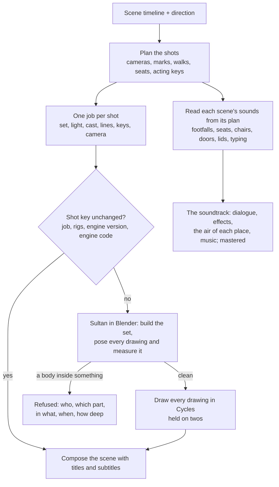

# Architecture

Clayvoyant is one Python package, `sastudio`, with a command-line interface. A
project is a folder of plain files; the package reads it, never changes it except for the output
and state folders, and builds a film from it.

## From configuration to film



1. **Load and validate** (`project.py`, `schema/project.schema.json`). YAML is read with a safe
   loader that refuses anchors and aliases and caps file size. The schema checks structure; then
   semantic checks look at speakers, tokens in every language, scene dependencies, file paths and
   voices.
2. **Resolve text** (`text/template.py`, `text/speech.py`). Each line's tokens (`{leo}`,
   `{org.security_email}`) are resolved twice: display text for subtitles and cards, spoken text
   for the voice (spoken names, pronunciation hints, the lexicon, email addresses as words).
3. **Plan and generate voices** (`voices/`). The plan hashes each request into a cache key.
   Missing lines are generated by the character's provider under the budget rules; paid providers
   run only with `--live` and a character budget.
4. **Prepare lines** (`audio/ffmpeg.py`). Every take becomes mono 48 kHz audio, trimmed and
   levelled, so mixed providers sound consistent.
5. **Build timelines** (`timeline.py`). Each scene becomes a list of beats (title, lines, cards,
   key point), each a whole number of frames, so picture and sound cannot drift apart.
6. **Render scenes** (`render/cards.py`, `render/style.py`). Scenes whose key changed are drawn
   with Pillow and encoded with FFmpeg, several at a time.
7. **Assemble and verify** (`build.py`). Scenes are joined, the audio is mixed and mastered, the
   MP4 is muxed and checked with `ffprobe`, and subtitles, transcript and manifest are written.

## The clay path

A clay film (`sastudio film`) shares steps 1 to 5 and 7. Instead of drawing cards, it films every scene
in Sultan, the clay engine, one shot at a time:



1. **Plan** (`direction.py`, `stopmotion/`). The direction becomes shots, and each shot a job: the set,
   the light, the cast with their marks, the lines with their timing, every acting key and the camera.
2. **Pose and measure** (`engine/clay/film.py`, `contacts.py`). Every drawing of the shot is posed as it
   will be filmed and measured triangle against triangle; the engine corrects what it can as it poses
   (`film.settle`), and a shot that would still show a body inside anything is refused before a single
   drawing is made ([CLAY_MOTION.md](CLAY_MOTION.md#nothing-passes-through-anything)).
3. **Draw** (Blender's Cycles). Each drawing is held for two frames, as stop motion is.
4. **Sound** (`engine/clay/sounds.py`, `sound/`). The same plan is read once per scene, without posing
   or drawing, for everything in it that makes a sound; the events are placed on the drawing that first
   shows their cause, made from recordings or by code, played in the room of their set, mixed under the
   voices and mastered ([SOUND.md](SOUND.md)).

Shots, scene videos and each scene's events are cached by content, so a change to the sound alone
films nothing again, and a change to the engine's code films the affected shots again.

## Modules

| Module | Responsibility |
|---|---|
| `cli.py` | The `sastudio` commands. Each one calls the modules below; none contain logic of their own. |
| `share.py` | `sastudio share`: the film without subtitles in the picture, then laid out upright for a phone with large captions, under a size limit. |
| `posters.py` | `sastudio posters`: each scene's lesson as an A4 or Letter page (PNG) and one PDF per language. |
| `brief.py` | `sastudio brief`: a writing brief read from the validator's own tables, for a person or a chat assistant. |
| `project.py` | The project model, loading, validation, display/spoken text resolution. |
| `schema/project.schema.json` | The project file format, version 1. |
| `migrate.py` | Upgrades older project files when the format changes (none yet). |
| `text/template.py` | Dialogue tokens: names, forms, pronouns, gendered choices, organisation fields. |
| `text/speech.py` | Spoken-text rules: lexicon, abbreviations, emails and URLs read as words. |
| `text/romanize.py` | Hindi in Roman letters (`hi-Latn`): the Hindi film's words spelled the everyday way, with `data/romanize_hi.json` for borrowed and settled words. |
| `voices/base.py` | The provider interface, request and audio types, WAV checks, retry policy. |
| `voices/kokoro.py`, `recorded.py`, `offline.py`, `sarvam.py`, `elevenlabs.py` | One adapter per provider: validation against its catalogue, request building, error mapping. Kokoro (free, on this computer) also reports phoneme timings; recorded reads your own files. |
| `voices/registry.py` | Looks providers up by name. |
| `voices/engine.py` | Plan, cache, budget, rate limit, retries, lock and ledger. |
| `voices/lexicon.py` | Exports pronunciations in each provider's own format. |
| `audio/ffmpeg.py` | Every FFmpeg and ffprobe call, always with an argument list. |
| `sound/events.py` | Sound events: their kinds, a stable identity for each, placement on the first drawing that shows the cause, and one sound per action. |
| `sound/foley.py` | Foley made by code: modal synthesis for impacts and footsteps, friction for creaks and scrapes, original ring tones. |
| `sound/kit.py`, `sound/packs.py` | Where each sound comes from: your own recordings first, then an installed CC0 pack (fetched only by `sastudio sounds install`, checked against a pinned checksum), then Foley made by code. |
| `sound/ambience.py` | Rooms (Sabine's reverberation time from each set's size and surfaces, early reflections) and the air of each place, never looped. |
| `sound/mix.py` | Four buses, dialogue first: effects panned and played in their room, beds and music measured and set under the voices, ducking from an envelope of the dialogue, equal-power fades. |
| `sound/meter.py`, `sound/master.py` | ITU-R BS.1770-4 loudness; the master's gain, its look-ahead true-peak limiter and the loop that measures the encoded film. |
| `sound/dsp.py`, `sound/config.py`, `sound/soundtrack.py` | Deterministic signal tools; the `sound:` settings with their defaults; a film's whole soundtrack from the build's timelines. |
| `timeline.py` | Beats, frame counts and audio placement. |
| `subtitles.py` | Cues, wrapping, SRT, WebVTT, transcripts and timing checks. |
| `render/cards.py`, `render/style.py` | The cards renderer and the compositor clay films share: fonts per script, colours, contrast, text fitting, subtitles. |
| `render/figures.py` | Drawn characters in three styles, made from the same text description as the clay ones. |
| `render/clay.py` | Sculpting the clay characters (cached per look) and what the clay renderer needs to know about this machine. |
| `claydesign.py` | From a character's `look.design` to sculpt parameters. |
| `direction.py` | The planner and its vocabulary: sets and marks, cameras, light, gestures, openings, endings; validation of every `direction:` key. |
| `models.py` | Your own 3D characters: inspect, import and export glTF/GLB, FBX and OBJ. |
| `stopmotion/` | Writes a job per shot (set, light, cast, lines, acting keys, camera) and films it in Blender; shot cache, keyed by the engine's code too. `stopmotion/check.py`: `sastudio check`, every drawing posed and measured, nothing drawn. |
| `lipsync.py` | Mouth shapes from phoneme timings, or from the words (Latin and nine Indian scripts) and the loudness of the voice. |
| `engine/sculpt/` | The sculptor: signed-distance forms and marching cubes (numpy, scipy, scikit-image). |
| `engine/clay/` | Sultan, the clay engine (`stopmotion.ENGINE_NAME`), named after Ibrahim Sultan. What Blender runs: the puppet, the hand and face rigs, acting, sets, light, the film runner, guest models. `body.py` is how a body of given proportions sits on a measured seat and how much room it needs (plain arithmetic, tested without Blender); `contacts.py` measures what passes through what in a posed drawing, what holds each body up and whether a standing foot slides, before a shot is filmed. `sounds.py` reads what makes a sound from a scene's plan. [RESEARCH.md](RESEARCH.md) gives the published measures and studies the engine follows. |
| `build.py` | The pipeline above, incremental keys and the manifest. |
| `doctor.py` | Environment checks. |
| `safepath.py` | Keeps every path inside its folder; atomic writes. |
| `errors.py` | Error types, each with a fix and an exit code. |
| `templates/` | `starter` (12 scenes), `short` (3, English and Hindi), `education`, `india` (5 scenes of its own, English and Hindi). |
| `data/` | Bundled fonts (Latin, Devanagari and eight more Indian scripts, each with its licence) and the provider catalogues. |
| `engine/characters/` | Parameter files describing the five clay characters' appearance. |

## Outside the package

| Folder | What it holds |
|---|---|
| `examples/` | Complete projects: `the-fast-one` (the clay sample film), `nineteen-thirty` (the India sample, English and Hindi), `held-door` (a short clay film whose sound is all made from what happens in it), `quillmere` (the cards renderer with a fictional company). |
| `tests/` | The test suite. Tests that need Blender or FFmpeg skip with a reason when they are missing; none touch the network. |
| `tools/` | Maintainer scripts, run from the repository root. `check_contacts.py` checks a filmed (or planned) project for intersections; the `make_*` scripts rebuild every picture and film in `docs/media` from the code, so none of them is hand-made; `make_example_music.py` makes Held Door's placeholder theme the same way. |
| `docs/` | The guides, `releases/` (the notes published with each version) and `media/` (everything the README shows). |

## A project folder

```
my-film/
  studio.yaml              the film: organisation, characters, scenes, voices, render settings
  scenes/*.yaml            one file per scene
  assets/                  logo, portraits, optional backdrops and music
  .env                     API keys (optional; never committed)
  build/<language>/        finished films, subtitles, transcripts, manifests
  .studio/
    cache/voices/<provider>/   generated speech, by content hash
    work/                      prepared lines, scene videos, intermediate audio
    ledger.jsonl               every paid or free generation request
```

## Design rules

- **Configuration is data, never code.** Projects can't run code. Every path stays inside the
  project folder, and every external program is started with an argument list, never a shell.
  See [SECURITY.md](../SECURITY.md).
- **Stable ids, resolved names.** Characters, scenes and lines are referred to by id. Display
  names, spoken names and organisation details are resolved at build time.
- **Nothing billable by accident.** Paid speech needs `--live` and a budget. Install, tests, dry
  runs and CI never call a paid API.
- **Content-addressed caches.** Speech and scene videos are reused when their inputs are
  unchanged, so a small edit costs a small rebuild.
- **Verify the output.** Frame counts, durations and audio length are checked with `ffprobe`
  before a film is reported as done.

## Versions you can rely on

- `schema_version: 1` is the project format. A future format will come with a migration in
  `migrate.py`, so existing projects keep working.
- Cache keys include a format version (`PREP_VERSION`, `RENDER_VERSION` in `build.py`) and the
  package version, so an upgrade re-renders what it must and nothing is reused incorrectly.

## Extending

- **A voice provider**: subclass `Provider` in `voices/`, register it in `registry.py`, add it to
  the schema's provider list, and test it with a fake transport. See [CONTRIBUTING.md](../.github/CONTRIBUTING.md).
- **A scene template**: YAML only. See [SCENES.md](SCENES.md).
- **A language**: translations in the scene files, `project.labels` for the renderer's own words,
  and a font that covers the script (Latin and Devanagari are bundled).

See [GLOSSARY.md](GLOSSARY.md) for the terms used here.
