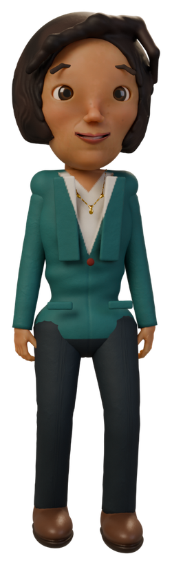
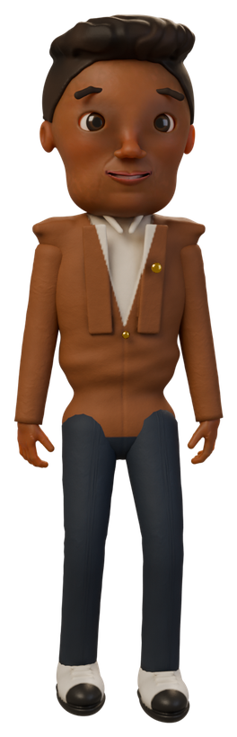
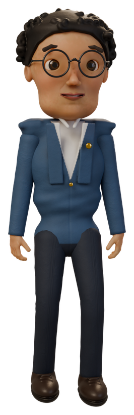
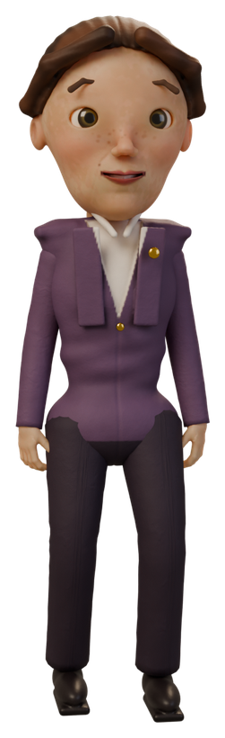
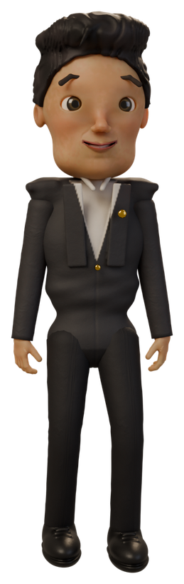
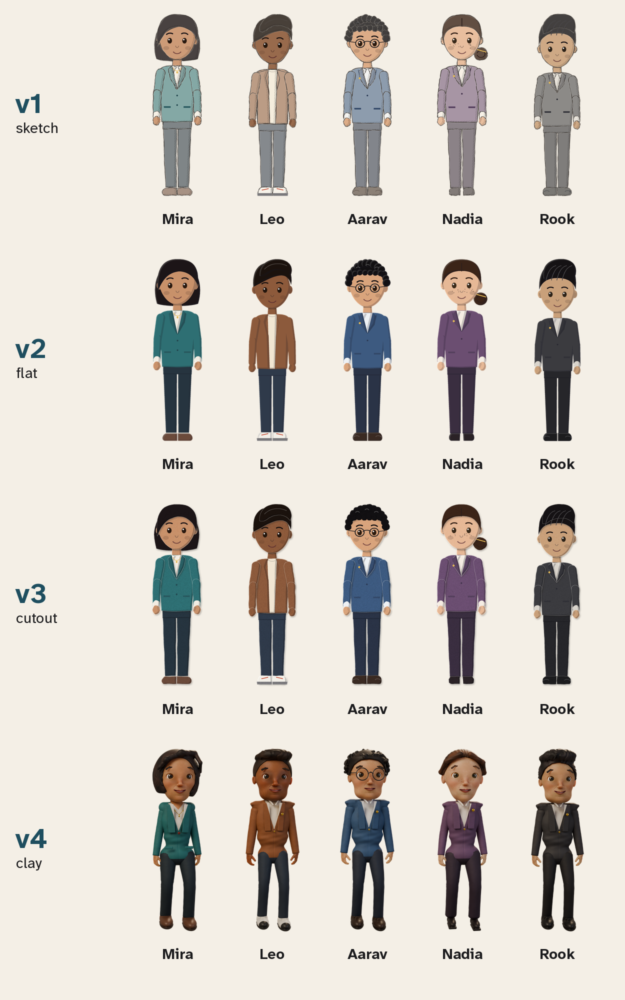

# Characters

## The cast

| | Id | Role | Look |
|---|---|---|---|
|  | `mira` | Security lead. Calm, dry, kind. | Dark bob, teal blazer |
|  | `leo` | New starter. Enthusiastic, too trusting, learns fast. | Side-swept hair, terracotta jacket, white sneakers |
|  | `aarav` | Finance. Careful, deadpan. | Short curls, round glasses, navy jacket |
|  | `nadia` | Operations manager. Busy, brisk. | Low bun, plum jacket |
|  | `rook` | The impersonator. Charming, never who they say. | Swept-back hair, charcoal suit |

All five were designed for this project.

## What you can change, and how hard it is

| Change | How | Re-voices? | Re-renders |
|---|---|---|---|
| A character's **name** | `name:` in studio.yaml | Only lines that say the name | Scenes that show it |
| How the name is **said** | `spoken:` or `pronunciation:` | Lines that say it | Those scenes |
| **Pronouns / grammar** | `pronouns:`, `gender:` | Lines that use them | Those scenes |
| **Voice** | `voice:` | That character's lines | Their scenes |
| **Portrait** | `look.portrait:` any PNG with a transparent background | No | Scenes they appear in |
| **Add a character** | add to `characters:`, then describe them (`look.design`) or give them a portrait, and lines | Their lines | Their scenes |
| **Remove a character** | delete them and their lines | | `validate` lists every line that still uses them |
| **Style** of every character, or of one | `render.character_style:` or `look.style:` (v1-v4, below) | No | All scenes, or theirs |
| **Appearance** in the drawn styles: hair, skin, outfit, shoes, glasses... | `look.design:` (below) | No | Scenes they appear in |
| **New clay characters** | describe them with `look.design`; `sastudio film` sculpts them | text | no |

Ids never change when names do. That is what keeps renames safe. The worked example in
[examples/quillmere](../examples/quillmere/) renames `leo` to Kabir in English and Hindi without
touching a scene file.

A new character needs either a design (below: no drawing skills, no files) or a portrait. Any PNG
with a transparent background works as a portrait: an illustration,
a photo cut-out you have the rights to, or a render from your own 3D tool. Keep the proportions of
the bundled portraits (a full standing figure about 3 times taller than wide) so the layout
matches. Without a portrait, the cards renderer draws a plain silhouette in one colour with the
character's initials.

## Four styles



| Style | Name | Looks like | Moves |
|---|---|---|---|
| `v1` | `sketch` | graphite outlines over a light wash, hatched shadows: a storyboard page | the speaker talks and blinks |
| `v2` | `flat` | clean flat colour, one shadow per shape: an explainer video | the speaker talks and blinks |
| `v3` | `cutout` | layered paper with cut edges, cast shadows and grain: paper stop-motion | the speaker talks and blinks |
| `v4` | `clay` | a still of the sculpted clay character (the default) | no in a cards film; fully in a clay film (`sastudio film`) |

Choose one for the whole film, and override it for any character:

```yaml
render:
  character_style: v3          # or: sketch, flat, cutout, clay
characters:
  - id: rook
    look: { preset: rook, style: v1 }   # Rook alone in sketch style
```

See your cast in every style before you render: `sastudio characters my-film --sheet cast.png`
(add `--styles v1,v3` to choose).

The drawn styles (v1-v3) are drawn by this tool, from scratch, every time: there are no image files
to download or license. The speaking character's mouth follows the voice (its loudness, or the
letters of the subtitle when the voice is the silent placeholder) and their eyes blink, changing
12 times a second like stop-motion animation. Bodies do not move and the cards still cut from one
to the next. Drawing is deterministic: the same design always gives the same pixels, and each
figure is drawn once and kept in `.studio/work/figures`.

## Describe your own character

A design is a few words in `studio.yaml`; anything you leave out comes from the character's
`preset` (one of the five) or a neutral default.

```yaml
  - id: priya
    name: Priya
    role: Branch manager
    look:
      design:
        skin: "#A8704C"
        hair: { style: bun, color: "#16100E" }
        outfit: { style: kurta, color: "#8E2F4B", shirt: "#F3D9A4" }
        trousers: "#2C3440"
        shoes: { style: flat, color: "#3A2C24" }
        extras: [bindi, earrings]
```

| Field | Choices |
|---|---|
| `skin`, `eyes`, `lip`, `blush`, `trousers` | any colour as `#RRGGBB` |
| `hair.style` | `short`, `side_sweep`, `swept_back`, `curls`, `bob`, `bun`, `long`, `ponytail`, `headscarf`, `bald` (with `hair.color`; for `headscarf` it is the scarf's colour) |
| `outfit.style` | `blazer`, `suit`, `jacket`, `shirt`, `sweater`, `kurta` (with `outfit.color` and `outfit.shirt`) |
| `shoes.style` | `flat`, `sneaker`, `brogue`, `heel`, `boot` (with `shoes.color`) |
| `extras` | any of `glasses`, `necklace`, `lapel_pin`, `freckles`, `earrings`, `beard`, `moustache`, `bindi`, `lanyard` |

`outfit.style` also takes `hoodie` and `vest` (a knit vest over a shirt; add `lanyard` to `extras` for an ID card on
a lanyard, the office version).

In a cards film, a character with a design but no clay still is drawn in `v2` flat; make its still
with `sastudio clay portraits my-film`. In a clay film every character is sculpted from its design.

## Sculpted in clay

`sastudio film` sculpts each character from the same design, with a real face, hands and
clothes ([how](CLAY_MOTION.md)). More can be said about a person there:

```yaml
    look:
      design:
        body: { build: broad, height: tall }     # slim | average | broad; short | average | tall
        face: { jaw: 0.5, nose: -0.3, eyes: 0.4 }
      acting: { manner: calm, age: older, energy: 1.2, posture: 0.5 }
      seed: "second draft"                        # a different set of small differences in the face
```

| Field | Meaning |
|---|---|
| `design.body.build`, `.height` | the width and the height of the figure |
| `design.body.frame` | `feminine`, `masculine` or `neutral` proportions (default: from the character's `gender`) |
| `design.face.*` | sliders from -1 to 1: `width`, `jaw`, `chin`, `nose`, `nose_width`, `cheeks`, `brows`, `eyes`, `length`, `mouth`, `lips` |
| `acting.manner` | `calm`, `confident`, `nervous`, `lively`, `reserved`, `warm` or `stern`: their habits, below |
| `acting.age` | `young`, `adult` (the default) or `older`: how long sitting down and getting up take, how fast they walk and turn, a slight stoop |
| `acting.energy` | how big the gestures are (0.2 to 1.6) |
| `acting.looseness` | how much the body sways and drifts (0.2 to 1.6) |
| `acting.posture` | -1 slouched to 1 very upright |
| `acting.pace` | how fast they walk (0.6 to 1.6) |
| `acting.gaze` | 0 holds the eyes steady on whoever matters, 1 looks about: glances away while listening, and looks away as a line begins more often |
| `acting.blink`, `.smile`, `.gestures` | how often they blink, how far a pleasant face smiles, how often a speaker's hands find a new shape (1 is average: about 17 blinks a minute at rest, 26 talking, 4.5 reading or typing) |
| `acting.reaction` | seconds before their face answers what it hears (0 to 1.5) |
| `acting.stride` | step length, on top of what their legs give (0.7 to 1.3) |
| `seed` | every character id gets its own small differences in the face; a seed picks another set |
| `clay` | `{ head: {...}, body: {...} }`: sculpt parameters set outright, for the curious (`engine/sculpt`) |

A manner is a set of habits, and any number above changes one of them:

| Manner | How it shows |
|---|---|
| `calm` | steady eyes, unhurried hands, reacts after a beat |
| `confident` | holds your eye, stands up straight, firm and economical gestures |
| `nervous` | eyes that wander, more blinking, small quick gestures, a little folded forward |
| `lively` | big and frequent gestures, quick to react, smiles readily, nods along |
| `reserved` | few and small gestures, slow to react, a small smile |
| `warm` | smiles readily, nods along, easy eye contact |
| `stern` | a fixed gaze, hardly smiles or nods, upright |

The rest comes from the body itself: longer legs take longer steps, a heavier build moves more
with each one, and a shorter person sits on a high sofa with the toes down. Two people given the
same gesture do it their own way, and the same project always gives the same performance.

Extras in clay: `glasses` and `earrings` are separate hard objects, `beard` and `moustache` are
clay laid on the face that moves with the mouth, `freckles` and `bindi` are painted, `necklace`
and `lapel_pin` appear on the tailored jackets, and `lanyard` hangs an ID card over the knit vest. A `headscarf` is
matte cloth wrapped round the head.

Useful commands: `sastudio clay build my-film` sculpts the cast (about 25 seconds each, then
cached); `sastudio clay portraits my-film` renders a still of each;
`sastudio model export my-film --as priya --out priya.glb` writes one to a file other tools open.

## About the five bundled characters

Mira, Leo, Aarav, Nadia and Rook have their own sculpt files in
`src/sastudio/engine/characters/` (face proportions, hair, glasses, garment, colours), so their
faces are exactly as they were first sculpted. `look.preset` selects one; `look.colors` (`skin`,
`hair`, `eyes`, `top`, `accent`, `bottom`) recolours it; a `design` on top changes only what it
names. The portraits in `assets/characters/` are stills of those sculpts.

## Likeness and rights

All five were designed for this project and are not based on real people. If you add
characters, do not use a real person's likeness without their written consent, and record the
licence of every image you add in [ASSET_LICENSES.md](ASSET_LICENSES.md).
