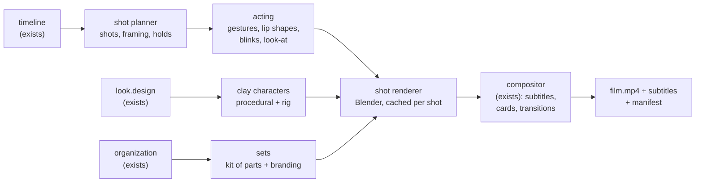

# Clay motion: design for an open clay-animation renderer

**Status: in development, experimental.** `sastudio render` still makes cards films: the drawn
styles (v1 sketch, v2 flat, v3 cut-out) move the speaker's mouth and eyes, and the clay style (v4)
shows still portraits. A first clay stop-motion renderer exists as an experimental command that
films one scene at a time. This page describes the whole renderer, what already works, and what
it costs to run.

## Where it stands

| Milestone | State | What works | Not yet |
|---|---|---|---|
| M1 Direction | **Done** | cameras, moves, lighting, gestures, sets and transitions per scene, planned automatically or written by hand, validated, printed by `sastudio direct` ([DIRECTION.md](DIRECTION.md)) | |
| M2 Clay characters | **Prototype** | built in Blender from the same `look.design` as the drawn styles: soft clay bodies, jointed arms, bead eyes and lids, hair styles, kurta, glasses, beard, bindi | simple puppet shapes; no hands with fingers; no fabric detail |
| M3 Acting | **Partial** | replacement mouths following the words, blinks, eyelines to whoever speaks, breathing, head and arm gestures (nod, shake, tilt, point, wave, shrug, open palms, thumbs up, hand on chin, arms folded, phone to ear, typing) | walking, sitting, props in hands, facial expressions from `emotion`, phoneme lip sync, real voice timing |
| M4 Sets, cameras, transitions | **Partial** | one miniature room with the organisation's logo framed on the wall, lighting presets, the planned camera, lens, depth of field and moves, a cache that reuses unchanged shots | every set renders as the same room with that set's props; transitions other than a cut; insert shots |
| M5 Affordable full film | Not started | | held poses with replacement mouths, render estimates, assembly into `sastudio render`, audio |

## Try it (experimental)

You need [Blender](https://www.blender.org/download/) 4.2 or newer (tested with 5.2.2) and a GPU
that Blender's EEVEE can use. Tell Security Awareness Studio where Blender is if it is not on
your PATH:

```bash
export SASTUDIO_BLENDER=/path/to/blender          # Windows: set SASTUDIO_BLENDER=C:\path\to\blender.exe
sastudio direct my-film --scenes too_good_email   # read the shot list first
sastudio motion my-film --scene too_good_email --preset draft     # one scene, 960x540
sastudio motion my-film --scene too_good_email --shot 3           # one shot
```

Under WSL2, point `SASTUDIO_BLENDER` at the Windows `blender.exe`: Linux Blender inside WSL could
not start EEVEE on the GPU in our tests, and the Windows build can. The clip is written to
`my-film/build/motion/`. It is silent, with subtitles, and is not yet part of `sastudio render`.

Measured on the reference laptop (GTX 1660 Ti, Windows Blender 5.2.2, 1280x720, 16 samples), for
the worked example's phishing scene directed with gestures (10 shots, 61.6 s of film):

| Run | Shots filmed | Shots reused | Time |
|---|---|---|---|
| First time | 10 | 0 | 602 s |
| Nothing changed | 0 | 10 | 9.8 s |
| One gesture changed | 1 | 9 | 72 s |

## What it should do

- Turn the same project files (organisation, characters, scenes, voices, languages) into a film
  whose clay characters act: they walk into a scene, gesture, react, turn to each other and talk
  with lip shapes that match the words.
- Stage each scene with deliberate shots (wide, two-shot, close-up), camera moves and transitions
  that mean something, or a clean cut.
- Brand the sets from `organization` (logo on the wall, palette in the props) and build every
  character from the same `look.design` used by the drawn styles.
- Re-render only what changed: editing one line re-renders that line's shot, not the film.
- Run on an ordinary gaming laptop GPU, with a fast preview tier and an honest estimate before a
  long render starts.

Not goals: photorealism, motion capture, or a general animation package.

## Independence

The renderer must be original work that this repository can publish under its licence. It is
written from public documentation and general techniques (Blender's Python API, armatures, shape
keys, procedural modelling, standard lip-sync mouth sets) and from the specification on this page.
The clay engine mentioned elsewhere in these docs is not included and is not the basis for this
renderer. Contributors must not copy code or assets they do not have the right to share, and
every asset added records its licence in `ASSET_LICENSES.md`. Before a release that includes the
renderer, the maintainer checks it for overlap with any code the project cannot publish.

## How it fits the current pipeline

Everything before rendering already exists and stays the same: validation, dialogue, voices,
frame-exact timelines and the compositor that adds subtitles, name tags, title and key-point
cards. The compositor can already take a folder of rendered frames for each line and lay the
overlays on top, so a clay-motion renderer only has to produce frames for each shot.



| Stage | What it is | How it is tested |
|---|---|---|
| Shot planner | Pure Python. From the timeline, chooses shots (who is on screen, framing, camera move), holds and transitions, with rules such as keeping screen direction and holding long enough to read. | In CI, without Blender: same input gives the same plan; snapshot tests of plans. |
| Acting | A small library of named gestures (nod, shrug, point, phone to ear, typing, arms folded) chosen by tags in a line (`act: [shrug]`) or simple defaults; lip shapes from the audio (an optional lip-sync tool) or, for the silent placeholder voice, from the text; blinks, breathing, characters looking at the speaker. | In CI: timing curves and mouth-shape tracks as data. |
| Clay characters | Built procedurally from `look.design` with smoothed primitives and a standard armature, so a design written for the drawn styles also works in clay. A documented rig contract lets people import their own rigged character instead. | A turntable render per character and option; rig contract checks. |
| Sets | Office, home, café and street built from reusable parts; logo and palette from `organization`. | Render tests with the fictional example organisation. |
| Shot renderer | Blender in the background, one shot at a time, animated on twos (12 drawings a second, the stop-motion look). Each shot is cached by a hash of everything that affects its pixels. | Optional render tests on machines with a GPU. |

## Keeping renders affordable

1. **Shot-level cache.** A shot is re-rendered only when its own inputs change (characters in it,
   their acting, the set, the camera, the renderer version). Changing a voice re-renders only
   shots whose lip shapes changed.
2. **Animate on twos.** 12 drawings a second instead of 24 halves the frames and is the look of
   hand-made stop motion.
3. **Held poses with replacement mouths.** Most dialogue is a character holding a pose while they
   talk. For such a hold the body is rendered once and each mouth shape once in the same light,
   then the mouths are laid in frame by frame, as stop-motion studios do with replacement mouths.
   A 4-second line on twos becomes about 9 renders instead of 48.
4. **Preview tier.** 1280x720, few samples, simple lighting, for checking acting and timing.
5. **Estimate first.** The planner knows how many renders a film needs and multiplies by the time
   per render measured on your machine, before anything long starts.

## Measured on the reference laptop

Blender 5.2.2, NVIDIA GeForce GTX 1660 Ti (6 GB), Intel Core i7-10750H, 2026-11-10. A deliberately
simple test scene written for this measurement (two primitive figures, a floor, a wall, two lights,
a moving camera), 11 frames timed after the first:

| Engine | Size | Samples | Seconds per frame |
|---|---|---|---|
| EEVEE (Windows Blender) | 1280x720 | 16 | 0.29 |
| EEVEE (Windows Blender) | 1920x1080 | 16 | 0.53 |
| EEVEE (Windows Blender) | 1920x1080 | 64 | 1.22 |
| Cycles, CUDA (Linux Blender under WSL2) | 1920x1080 | 32, denoised | 11.94 |

Findings that shape the design:

- Under WSL2, Linux Blender could not start EEVEE without a display (no GPU device for EGL); the
  Windows build of Blender ran it on the same GPU. The renderer should support running Windows
  Blender from WSL, native Linux with a GPU-enabled OpenGL, and Cycles as the slow fallback.
- EEVEE was about 22 times faster than Cycles here. Real sets with several characters, props and
  depth of field will cost several times more per frame than this test; treat these numbers as a
  lower bound.

## What a full film would take (estimate, not a measurement)

The 12-scene starter film is 862.6 s long: 10,351 drawings on twos. With held poses and
replacement mouths, assuming 70 % of the time is dialogue in held shots, about 4,500 renders.

| Time per render (1080p) | Without the techniques above (20,703 frames) | On twos, with held poses (about 4,500 renders) |
|---|---|---|
| 0.5 s (simple sets) | 2.9 h | 38 min |
| 2 s (furnished sets) | 11.5 h | 2.5 h |
| 5 s (rich sets, depth of field) | 28.8 h | 6.3 h |

After the first render, the shot cache means an edit to one line costs that line's shot, which is
seconds to a few minutes.

## Milestones

| Milestone | Delivers | Done when |
|---|---|---|
| M1 Shot planner and animatic | Shots, holds and transitions planned from the timeline, previewed with the drawn characters (no Blender) | Plans are deterministic and snapshot-tested; an animatic of the starter film renders in minutes |
| M2 Clay characters | Procedural clay figures from `look.design`, with a standard rig; rig contract for imported characters | Turntable renders of every bundled character and every design option, checked by eye |
| M3 Acting | Gestures, lip shapes, blinks, breathing and look-at for one line | One line renders with readable lip sync and a gesture, composited with subtitles |
| M4 Sets, cameras, transitions | Kit-of-parts sets with branding, camera moves, transitions; the shot cache | A full scene renders; changing one line re-renders only its shot |
| M5 Affordable full film | Held poses with replacement mouths, preview tier, estimate before rendering | The starter film renders end to end within the estimate, on the reference laptop |

Until M5, the honest description of the project is: captioned training films with drawn
characters that talk and blink, or still clay portraits. Help with any milestone is welcome; see
[CONTRIBUTING.md](../CONTRIBUTING.md).
