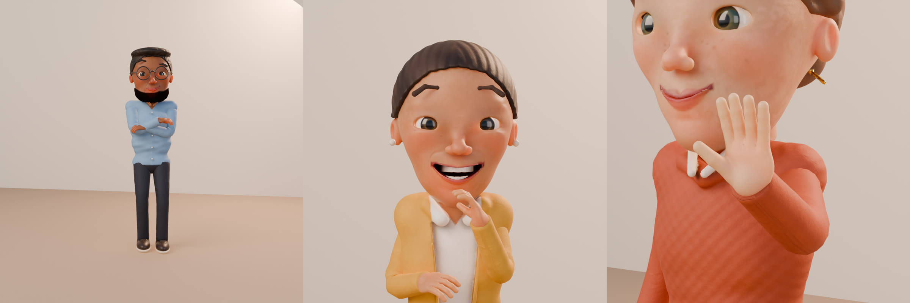

# Clay films: Sultan, the engine

Sultan is the engine that sculpts, acts, builds, checks and films every clay scene in Clayvoyant. It is
named after Ibrahim Sultan, who made it.

`sastudio film <project>` makes the whole film in clay stop motion: voices, sculpted characters,
sets, cameras, light, lip sync, subtitles. This page explains what happens between the text you
write and the frames you get, and where each part lives.

```bash
pip install -e ".[clay,voices]"          # sculpting and the free voice
sastudio voices install kokoro           # once
sastudio direct my-film                  # read the shot list before filming
sastudio motion my-film --scene first_day --shot 2    # a silent look at one shot
sastudio film my-film --preset draft     # the film
```

Blender 4.2 or newer must be on `PATH`, or named in `SASTUDIO_BLENDER`. On WSL2 either the Linux
build or the Windows `blender.exe` works; paths are converted for the Windows one.

## 1. Sculpting

A character is not assembled from parts. Its head, its clothes, its hands and its hair are each one
continuous form described by signed-distance functions (`engine/sculpt/sdfkit.py`): ellipsoids,
cones and coils of clay blended into each other, then carved (the parting of the lips, the eye
openings), then turned into a mesh by marching cubes. Colour is painted onto that mesh in washes,
the way a puppet painter does it, and creases are darkened by measuring the sculpt itself.

- `engine/sculpt/heads.py`: the skull on real facial proportions, a carved mouth, eyes with
  separate lids, brows, teeth and tongue, skin that is never one colour, beards and moustaches.
- `engine/sculpt/bodies.py`: eight garments (blazer, suit jacket, zip jacket, shirt, sweater,
  hoodie, kurta, knit vest), each with a real hem, plus shoes and the hand.
- `engine/sculpt/hair.py`: ten styles, each one mass that hugs the skull and is combed by a tool.
- `engine/sculpt/build.py`: builds a character's files (`.npz`) from one JSON of numbers.

Nobody writes those numbers. `sastudio/claydesign.py` turns the `look.design` in your project
(skin, hair, outfit, build, height, face sliders) into them, varies every face a little by
character id, and lets `look.clay` set any of them outright ([CHARACTERS.md](CHARACTERS.md)).
Sculpting takes about 25 seconds per character and is cached until the look changes.

<p align="center">
  
</p>

## 2. The puppet

Inside Blender, `engine/clay/puppet.py` puts the sculpt on a rig that is solved with plain
matrices every frame:

- a spine that bends, twists and squashes the torso mesh itself;
- sleeves and trouser legs swept along the bones each frame, bunching where they bend;
- an anatomical arm and hand (`handrig.py`): the elbow swings with where the hand is going, the
  forearm rolls and the wrist bends inside human limits, four fingers and a thumb curl through
  fifteen bones, so a palm can only turn the way a palm turns;
- a face of 21 controls (`faceops.py`) that move one continuous head mesh: jaw, lips, smiles and
  frowns per side, brows, squints, how wide the eyes open;
- clay, cloth, skin and eye materials (`claymat.py`): thumb-print whorls, fine grain, colour that is
  never flat.

## 3. Acting

`engine/clay/acting.py` is the performance. Everything in it is a pure function of the frame
number, which is what makes shots cacheable and resumable.

- **Walking.** Feet plant ahead of the hips and stay planted; the pelvis rises over the standing
  foot and sinks between steps; heel strikes, toe leaves; arms swing against the legs; a walk
  starts with a half step and ends with a settling one. Every walk, turn and stop starts from where
  the feet actually are, so a route with corners is one walk, not a string of fresh starts. A foot
  on the floor keeps its place and its direction until it lifts, and turns in the air; a rising
  heel pivots on the ball of the foot, a heel strike on the heel.
- **Sitting.** Worked out from each body's own legs and each seat's measured shape (below).
- **Hands.** More than forty gestures, each a place for the hand, a finger shape and a wrist. Hands travel in
  arcs, arrive a beat apart, settle past their mark, and never snap when a new gesture interrupts.
- **Speech in the body.** The stressed sounds of a line nod the head, lift the brows and beat the
  hands. A speaker changes gesture on the thought, not on a timer.
- **Eyes.** Eyes lead, the head follows, the body last. Small saccades, and a blink on every big
  turn. Blinking follows what a person is doing: about 17 a minute at rest, 26 while talking and
  4.5 while reading or typing, scaled by their habit, and a listener blinks just after most lines
  end. A speaker looks away as most lines begin, the longer ones nearly always, and is back on the
  listener well before the end. Listeners look at the speaker, nod as far as they agree with what
  they hear, and glance away now and then if that is their habit or they are unsettled.
  [RESEARCH.md](RESEARCH.md) gives the studies these numbers come from.
- **Feelings.** Twenty-one faces, blended from one to the next, that stay under the words. How a
  line is said decides what the speaker's hands do: open and easy, firm, unsettled (close to the
  body, a hand to the chest) or thinking (a hand to the chin). A laugh is bursts of breath that move
  the shoulders, the head and the jaw together, then fade.
- **Habits.** Each character's manner and age (`look.acting`, [CHARACTERS.md](CHARACTERS.md)): how
  steadily they look, how often they blink, how often and how big they gesture, how much they smile
  and nod, how quickly they react, how long sitting down takes. Their own legs set their stride.
- **Things.** A mug or a phone is carried in the palm; a hand that carries does not swing.

Lip sync uses the nine mouth shapes of the Rhubarb alphabet. When the voice provider reports the
time of each sound (Kokoro does), the mouth follows them; otherwise `sastudio/lipsync.py` reads
the shapes from the spelling and lays them over the parts of the audio where someone is speaking.

## 4. Places and light

`engine/clay/setkit.py` is a kit of clay forms, furniture, props and lamps; `sets.py` builds eight
places from it. Nothing is loaded from a model, photograph or texture file. A set wears the
organisation's palette and name, and declares its *marks*: where people can stand or sit, which
seats have a table, where the door is.

Light comes from the lighting mood you choose (key, fill, rim, exposure), from the set's own lamps,
and from the time of day: by day the sun reaches a room through a window nobody sees, whose frame
throws real pane shadows across the floor and the far wall. Rooms have a ceiling the camera sees
and the light does not.

## 5. Filming

`sastudio/stopmotion` writes a *job* for each shot (set, light, cast, every line with its mouth
cues, every acting key, one camera) and `engine/clay/film.py` films it:

- The camera is placed from where the people really are: a close-up from the side a face is turned
  to, an over-the-shoulder from behind the listener, a wide from standing height. A subject who
  walks is followed. Depth of field focuses on the subject every frame.
- Two checks run on every placement. People are played towards the open front of the set, so when
  the listener stands upstage of the speaker an over-the-shoulder would see the back of the
  speaker's head: that shot is filmed as a two-shot from the front instead, and the log says so.
  And everyone a shot is on is projected through the real lens; if perspective pushes someone near
  the camera past the edge of the frame, the camera steps back until they fit.
- Every scene opens on a filmed shot of its place, with the title over it, entered by its
  transition (see [DIRECTION.md](DIRECTION.md)).
- Frames are drawn on twos: twelve drawings a second, each held for two frames.
- Each shot is stored under a hash of everything that can affect it. Changing a later line does
  not re-film an earlier shot. A shot that was interrupted resumes at its first missing drawing.
- Blender only runs the scripts shipped in this package. A job holds numbers, names from fixed
  lists and file paths chosen by `sastudio`; nothing in a project file is ever executed.

The filmed frames then go through the same compositor as every other film here: subtitles, name
tags the first time someone speaks, cards, the intro and outro, frame-exact audio, loudness
normalisation, the manifest with checksums ([RENDERING.md](RENDERING.md)).

## Nothing passes through anything

Every character is solid, and so is every piece of the set, measured on the surfaces as they are
drawn: bevels, the lumps of handled clay, a cushion as it is pressed in.

**Sitting.** A seat is measured from its own geometry (`film.measure_seat`): the height of its
surface where this person sits, its front edge, what stands under it (a sofa's base, a chair's
legs), its backrest, a table over the knees, a desk's panel in front of them. How a body sits on
it is worked out from that body's own legs (`engine/clay/body.py`): the thighs lie on the seat,
the knees come past its front edge, the feet stand on the floor in front of whatever is under it,
and a cushion gives under the weight. A short person on a high sofa points the toes down to the
floor; a tall one on a low chair sits with the knees up. On a sofa people settle back towards the
backrest; at a desk they sit up. Whatever stands on the floor in front of a seat (a cafe table's
foot, a rail between a desk's legs) is measured too, and the feet draw back from it, the shins
leaning back as far as they leaned forward, or further on the toes when that is not enough. A
chair's legs stand out at the sides, so feet can draw in under it; a sofa's base keeps them in front.
A chair is drawn in only as far as the legs let it: when the knees or the feet would meet a table's
edge or its foot even drawn back, the chair stays that much further out and the body sits with it.
A ponytail or a head that would touch a chair's back sits a little further forward instead.

**Getting to a seat.** A sofa and a bench seat two side by side, a shoulder's width apart and a
little more, so either can sit down or get up beside the other; a chair or a stool, one.
Somebody walks to a place in front of the seat with room to turn round,
turns with small steps, steps back and lowers: the hips go back before they go down, and the chest
comes forward over the feet. Getting up is the same in reverse, and someone seated who is sent
somewhere stands up first. Somebody blocked on a seat who walks in sits down when they get there.
A chair at a table is pulled out for them and drawn in under them. Somebody told to get up, or sent
somewhere else, before they reach their seat does not sit down when they get there: a new direction
replaces whatever the last one still had planned (the rest of the route, the turn, the sit), and the
log says so, because it usually means the lines leave too little time for the walk.

**Standing and walking.** Feet come down on the real surface under the whole sole. A planted foot
never skates or swivels: a walk ends with the feet side by side across the way they walked, a walk
that turns a corner or is sent somewhere else carries on from where the feet are, and a turn on the
spot goes in pairs of steps of at most 60 degrees, the leading foot opening out and the other coming
beside it, never past it. Round a corner the foot on the side turned to steps out first and the other
comes round outside it (a step turn); setting off behind or well to one side, the body turns on the
spot first. Sent back the way they came in the middle of a stride, a walker never reverses in the
air: the foot that is up comes down, the other joins it, they turn round on the spot and walk back.
Each footfall is planned clear of the other foot, and a stepping foot goes round the
standing one: the two shoes never touch, measured as the shapes they are on the floor.
Sitting down, one foot steps back and then the other, the same foot first all the way down (the one
on the side the body moves to): never both off the floor at once, and a foot turns to the seat's
way only while it is in the air. Somebody who walks into a room with no door comes through an opening in its side wall. Walks are routed round the furniture with room for the legs
and their stride. A standing place too close to furniture or to another person is moved the least
distance that clears it, and the log says so.

**The set itself.** Every loose thing a set puts down (a mug, a laptop, papers, books, a phone, a
monitor, a plant) rests on the highest point under it, and things that share a surface keep out of
each other: the smallest push that separates two outlines, or else the nearest free place on the
same surface, or else the bigger thing makes room; a thing may overhang its surface as long as its
weight is over it. Furniture rests on the floor. Walls with their windows, doors and skirting are one
construction, and so are floors laid edge to edge.

**Arms and hands.** Elbows and forearms stay outside the body: a hand on its way across the chest
goes round it, a hand laid on the chest rests on it, and hands resting on the thighs of a broad body
sit far enough out that the forearms clear the stomach, whatever the build. Seated, hands that
would hang at the sides rest on the thighs. A hand on the face rests on the outside of that head,
its hair and its glasses, whatever their shape. A carried mug or phone sits against the fingers of
the hand that holds it, and never goes into the body carrying it; it is in the hand once the fingers
have closed round it and gone as soon as they open, never through a hand still closing. Hands that
meet by design (palms together, clasped) touch, one never inside the other, and a hand resting close
to the other arm never sinks into its sleeve. A gesture made beside somebody ends short of them: the
hand, and the arm that carries it, give way by as much as they must, a little at a time. A hand never
goes through anything between one drawing and the next either: up out of a lap past a table's edge,
it comes up nearer the body, the side of the edge that is always clear.

**Hair.** Hair is soft. A ponytail, a bun or long hair that meets a wall or a chair's back lies
against it, the ends laid on its surface and the hair just behind them giving a little, as a cushion
gives under a body; nothing of it passes through. Each drawing starts from the hair as sculpted.

**Checked before anything is drawn.** Before a shot is filmed, every drawing is posed and measured
(`engine/clay/contacts.py`), triangle against triangle: each character against the set and the
props, against every other character, and against their own body away from the joints (a sleeve is
joined to its shoulder; past that it must stay out), and the set against itself. A hand or a foot whose path from one drawing
to the next goes through something counts too. So does a body that nothing holds up (`float`: no
sole within 5 mm of what is under it, or, seated, a seat that is not on the seat) and a standing foot
that slides on what it stands on (`skate`: more than 5 mm a frame), the measures motion research
uses for physical plausibility ([RESEARCH.md](RESEARCH.md)). A shot that would show a body inside anything is
not filmed: the log says who, which part, in what, when and how deep, and every one is listed in
the shot's `contacts.json`. `sastudio film --allow-intersections` films it anyway, still listing
them.

```bash
sastudio check my-film                    # every planned shot, posed and measured, nothing drawn
sastudio check my-film --filmed           # the shots of the last filming
python tools/check_contacts.py my-film    # the same, for maintainers
```

A check that cannot finish fails; it is never counted as clean. `sastudio validate` reports staging
a body cannot do before any of this: two people on one mark, a seat that is already taken, typing
away from a desk, a line spoken after its speaker walked out, an imported model sent to sit.

The shot cache is keyed by the engine's code as well as by `stopmotion.ENGINE_VERSION`, so a change
to how anything is posed or built films the affected shots again; a comment does not.

## Guests

A character can be a model somebody already has (`sastudio model import`). A guest is fitted to
the height of the cast, grounded by measuring its real, skinned geometry, stripped of any
animation stored in the file, and then stands, walks, turns, looks, talks, blinks and gestures as
far as its bones and shape keys allow. It does not sit and has no fingers to pose. The licence you
state for the model is recorded in the project.

## Measured

On 2026-11-11, on an Intel Core i7-10750H (12 threads) with a GeForce GTX 1660 Ti (6 GB), Blender
5.2.2 under WSL2 with CUDA:

| | |
|---|---|
| Sculpting the sample's three characters from nothing | 46 s in all, 0.9 GB at most |
| A drawing at `draft` (960x540, 6 samples) | 2.2 to 2.6 s (247 drawings, four shots) |
| A drawing at `preview` (1280x720, 12 samples) | 4.2 to 5.0 s, 4.7 s on average (666 drawings, 17 shots, two runs) |
| The whole sample film at `preview`, every shot filmed from nothing | 54 min 57 s and 55 min 11 s in two runs, 1.97 GB at most |
| Kokoro voice | 26 s for the sample's 47 s of speech, model loading included; 0.6 GB |
| Posing the puppets, per drawing | not re-measured (an earlier note said about 0.1 s) |

Going from `draft` to `preview` (1.8 times the pixels, twice the samples) roughly doubles the time a
drawing takes; more people in frame cost more. Environment variables: `SASTUDIO_BLENDER` (which
Blender), `SASTUDIO_CLAY_DEVICE` (`GPU` or `CPU`), `SASTUDIO_CLAY_STALL_MINUTES` (how long Blender
may draw nothing before it is stopped, default 20) and `SASTUDIO_CLAY_RETRIES` (default 1).

## Not built yet

Sound effects and ambience (a music bed of your own does work: `render.music`, ducked under the
dialogue); props beyond the mug and the phone; crowds; weather; rendering on a remote machine; a
visual editor. See [ROADMAP.md](ROADMAP.md).
