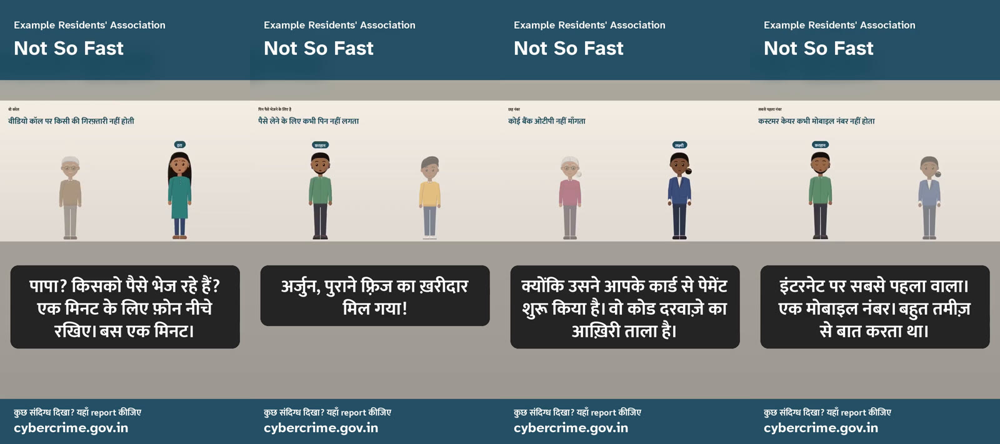
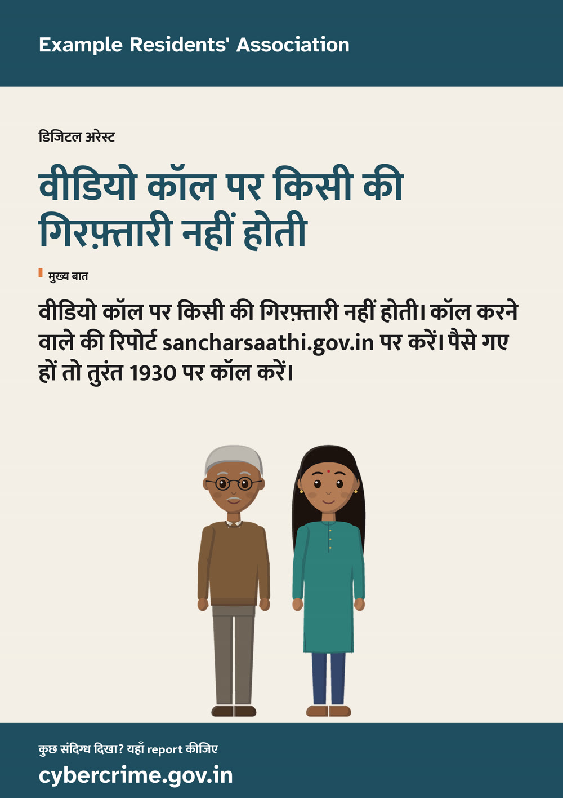
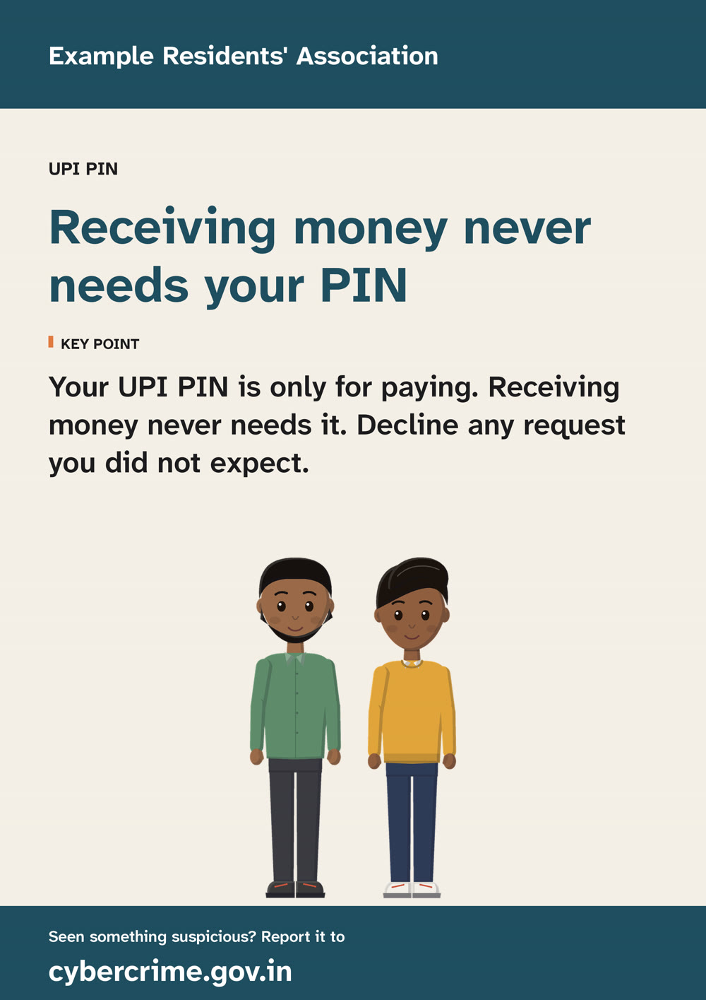
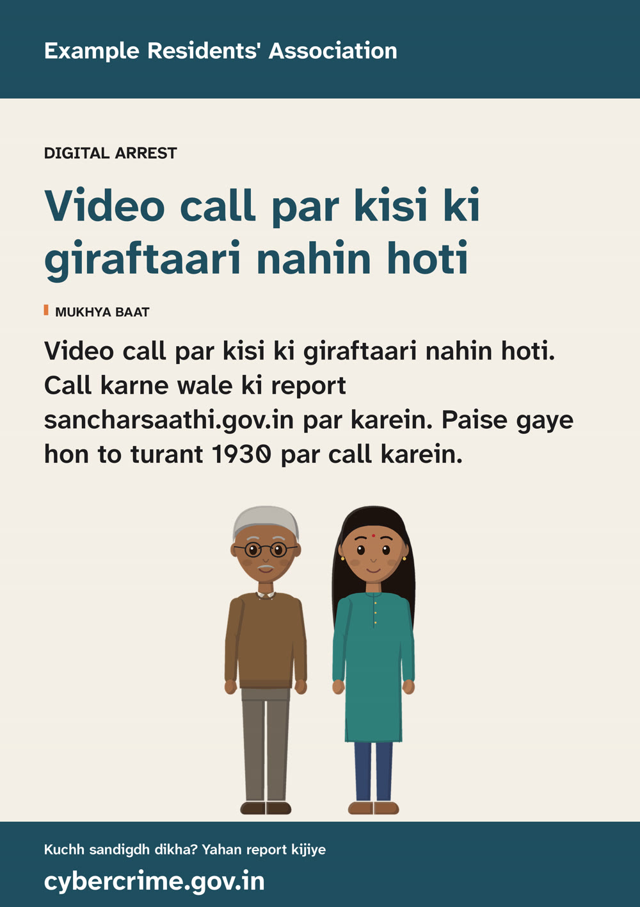

# Films for India

Most people in India who lose money to a scam are not careless. They are rushed, frightened or
flattered by someone who has done it a thousand times, often in a language and a register that
sounds official. What protects them is short and specific: nobody is arrested on a video call; a
PIN only ever sends money; no bank asks for an OTP; never install an app that arrives in a message;
customer care is never a mobile number. Those sentences are easy to say and hard to remember under
pressure. A story told with faces makes them stick.

Clayvoyant makes those stories on an ordinary computer, in English and Hindi, for nothing. A
school, a college, a housing society, a bank branch, a panchayat office or a family WhatsApp group
can make a film in its own name without a video budget, an account or an upload.

Schools, colleges, universities, panchayats and municipalities mark Cyber Jaagrookta Diwas on the
first Wednesday of every month ([CIET-NCERT](https://ciet.ncert.gov.in/activity/cjd_ssw)). These
films are made for that hour: one scam, a few minutes, in your own name and language.

## Start here

```bash
sastudio init my-film --template india --org "Sunrise Senior Citizens Forum" --email help@sunrise-forum.org
sastudio validate my-film
sastudio render my-film --preset draft              # drawn characters: no Blender, no graphics card
sastudio film my-film --preset draft                # clay stop motion
sastudio film my-film --preset draft --lang hi-IN   # the same film in Hindi
sastudio film my-film --preset draft --lang hi-Latn # Hindi voices, words on screen in Roman letters
```

The `india` template is five short scenes with six invented characters, each scene in English and
Hindi:

| Scene | The scam | What the film says |
|---|---|---|
| The Call | "Digital arrest": a video call from someone in uniform | Nobody is arrested on a video call. Report the caller; if money has gone, call 1930 at once |
| The PIN Is for Paying | A UPI "collect request" from a buyer who has "already paid" | A PIN only ever sends money. Receiving never needs it |
| Six Numbers | A caller "from the bank" who needs the OTP that just arrived | No bank asks for an OTP. Call your bank yourself |
| The Light Bill | A message that the electricity will be cut tonight unless you install an app | Never install an app from a message. Check on the company's own app or website |
| The First Number | A "customer care" number from the top of a web search | Customer care is never a mobile number. Never install a screen-sharing app for a caller |

The sample film [Nineteen Thirty](../examples/nineteen-thirty/) is the first scene on its own,
filmed in clay in both languages.

![Twelve frames from Nineteen Thirty, in clay, in a warm living room at evening. Gopal, grey-haired with round glasses and a white moustache, sits alone on a green sofa with a phone at his ear ("A parcel in my name?"), then in close-up ("Right now, on this video call?"); his daughter Ira, in a green kurti, arrives beside him ("Papa? Who are you sending money to?"); he spreads his hands ("He says I must stay on camera and tell nobody"); Ira in close-up, pointing ("Police, CBI, customs, judges: nobody arrests anyone on a video call"); Gopal protesting that the man had a uniform and a badge; Gopal admitting he sat there two hours; Ira leaning in ("That is the trick. Fear, hurry, and keep it secret"); Gopal saying not one rupee went; and the key point card: Nobody is arrested on a video call. Report the caller on sancharsaathi.gov.in. If money has gone, call 1930 at once.](media/film/nineteen-thirty-sheet.jpg)

**Watch Nineteen Thirty** (two minutes):
[English](https://cdn.jsdelivr.net/gh/xIBBAx/clayvoyant@4f9cbbc/docs/media/nineteen-thirty.en-IN.mp4) ·
[Hindi in Roman letters](https://cdn.jsdelivr.net/gh/xIBBAx/clayvoyant@4f9cbbc/docs/media/nineteen-thirty.hi-Latn.mp4) ·
Hindi in Devanagari and the phone versions are on the
[0.3.1 release](https://github.com/xIBBAx/clayvoyant/releases/tag/v0.3.1).

This is the template exactly as `init` makes it, rendered in Hindi with drawn characters on a
laptop processor (5 minutes 53 seconds of film in under four minutes, no graphics card):

![Twelve frames of the Hindi film, each with its headline at the top and a Devanagari subtitle: Gopal telling Ira it is the police, Ira saying the police station is a painted wall, Ira saying they will report the number on sancharsaathi.gov.in, the scene's key point card; Farhan reading out 'Pay ₹4,500. Enter UPI PIN.', Arjun saying money coming in never needs a PIN; Lakshmi telling Kamala she works in a bank, Lakshmi explaining the code is the last lock, the key point that no bank asks for an OTP; Gopal reading the electricity message, the key point never to install an app from a message; Farhan asking about the screen-sharing app.](media/india/not-so-fast-sheet.hi-IN.jpg)

The same film from `sastudio share`, for a phone held upright, and two pages from `sastudio posters`:



<p>
  
  
</p>

And the Hindi film with its words in Roman letters (`--lang hi-Latn`): the same voices, the same
pictures, spelled the way people type Hindi on a phone. The phone film, and the first scene's
poster:


<p>
  
</p>

## Where the advice comes from

Every line of advice in the template follows a public advisory. Each scene's `policy_note` names
its source. Check them again before you show a film: helplines and portals change.

| Advice | Source |
|---|---|
| The police, CBI, ED, customs and judges do not arrest anyone over a video call | Indian Cyber Crime Coordination Centre (I4C) advisory, October 2024, as [reported by ThePrint](https://theprint.in/india/cbi-ed-police-dont-arrest-people-through-video-calls-indian-cyber-crime-coordination-centre/2299608) |
| Report a cyber crime, or money lost to fraud, on 1930 or at cybercrime.gov.in | [National Cyber Crime Reporting Portal](https://cybercrime.gov.in) |
| Report a suspected fraud call, SMS or WhatsApp message (no money lost) on Chakshu | [Sanchar Saathi](https://sancharsaathi.gov.in), Department of Telecommunications |
| Receiving money never needs a UPI PIN; fraudsters misuse UPI "collect requests"; never share a PIN, UPI PIN or OTP, not even with bank officials | Reserve Bank of India, [Consumer Awareness: Cyber Threats and Frauds](https://www.rbi.org.in/scripts/BS_PressReleaseDisplay.aspx?prid=53185), 28 January 2022 |
| The "electricity KYC update" scam sends SMS and WhatsApp messages with malicious app files that take control of the phone | Department of Telecommunications, 17 June 2024, as [published by All India Radio](https://www.newsonair.gov.in/dot-takes-action-against-electricity-kyc-update-scam) |
| Fraudsters place their numbers in search results as a company's helpline; customer care numbers are never mobile numbers; screen-sharing apps are used to take over accounts | Reserve Bank of India, [BE(A)WARE: a booklet on the modus operandi of financial fraudsters](https://website.rbi.org.in/documents/87730/39016390/BEAWARE07032022.pdf), March 2022 |

When a source and a scene disagree, the source wins: change the line, and only the shots it
touches are filmed again.

## Languages

- **English and Hindi, free and offline.** Kokoro speaks Hindi with four voices and reports the
  timing of every sound, so mouths follow the words exactly. Subtitles are in Devanagari.
- **Bengali, Gujarati, Kannada, Malayalam, Marathi, Odia, Punjabi, Tamil, Telugu.** Two ways:
  - [Record the lines](VOICE_PROVIDERS.md#recorded): one file per line, a phone's recorder is
    enough. Free, and the voices are your own people's.
  - [Sarvam](VOICE_PROVIDERS.md#sarvam), a paid Indian service, with your own key, a spending cap
    and a ledger. Nothing paid runs without `--live`.

  Either way the mouths are timed from the script itself: lip sync reads Devanagari and the eight
  Indian scripts laid out like it (Bengali, Gurmukhi, Gujarati, Odia, Tamil, Telugu, Kannada,
  Malayalam) and lays the shapes over the parts of the recording where someone is speaking.
  Subtitles and cards are set in each script with bundled Noto Sans fonts, which also carry Latin
  for the web addresses and numbers inside a line.
- **Hindi in Roman letters (`hi-Latn`).** A great many people who speak Hindi read it, type it and
  forward it in Roman letters: "Papa, ek minute ke liye phone neeche rakhiye." The template lists
  `hi-Latn` next to `hi-IN`, and that film is the Hindi film (the same lines, the same voices, the
  same filmed shots) with every word on screen in Roman letters: subtitles, titles, key points,
  posters and phone captions. You write nothing twice. The Hindi lines stay in Devanagari, which
  is what a voice reads best, and the film spells them out:

  | The line, as written | On screen in `hi-IN` | On screen in `hi-Latn` |
  |---|---|---|
  | `पापा? किसको पैसे भेज रहे हैं?` | पापा? किसको पैसे भेज रहे हैं? | Papa? Kisko paise bhej rahe hain? |
  | `वीडियो कॉल पर किसी की गिरफ़्तारी नहीं होती` | वीडियो कॉल पर किसी की गिरफ़्तारी नहीं होती | Video call par kisi ki giraftaari nahin hoti |

  English words Hindi has borrowed come back as English (वीडियो कॉल is "video call", ओटीपी is "OTP"),
  from a list anyone can add to: [`romanize_hi.json`](../src/sastudio/data/romanize_hi.json). The
  rest is spelled letter by letter the everyday way (करना is "karna", में is "mein", नहीं is "nahin").
  To word a line yourself, give it its own text and it is used as written:
  `translations: { hi-IN: "वो कॉल", hi-Latn: "Woh Call" }`. Want only Devanagari, or only Roman
  letters? Keep the one you want in `project.languages`. It is everyday spelling, not a scholar's
  transliteration, and it exists for Hindi so far.
- **Hinglish.** Write lines the way people talk. Kokoro's Hindi voices read Devanagari, so write the
  English words people use the way they say them (कॉल, ऐप, ओटीपी). Show a web address or a number one
  way and say it another with `spoken:` (the template shows "1930" and says "उन्नीस तीस").

Every translation in the template was written for it and should be read by a fluent speaker from
your audience before you film. Kokoro has no Indian-English accent: English lines are read in a
British voice.

## Making it yours

- **Your name.** `--org`, `--email` and `--logo` put your organisation on the title and credits.
  The reporting address stays the national portal unless you change `reporting_url`.
- **Your people.** Change a character's name, clothes, skin, hair, glasses or bindi in
  `studio.yaml` ([characters](CHARACTERS.md)). Every line uses `{id}` tokens, so a rename reaches
  every scene and both languages.
- **Your scams.** `sastudio brief my-film "a loan app that threatens to message your contacts"`
  prints a brief any chat assistant can write a new scene from
  ([how](WRITING_WITH_AN_ASSISTANT.md)). Look up every fact it writes.
- **Your screens.** Films play from a laptop, a projector or a phone. The subtitles are in the
  picture, so a muted WhatsApp video still works.
- **Your phones.** `sastudio share my-film` lays each film out for a phone held upright: your name
  and the title at the top, the film across the middle, each line's words below it in large type in
  its own script, and where to report along the foot, encoded to stay under 15 MB (`--max-mb`).
  It also leaves a copy without subtitles in the picture, with its `.srt`, for players that show
  their own captions. `--each` makes one clip per scene instead: about a minute and 5 MB each, one
  scam per forward.
- **Your walls.** `sastudio posters my-film` prints each scene's lesson as an A4 page (or `--size
  letter`), in every language of the project: your name and colours, the topic, the headline, the
  key point, the people from the scene, and where to report. One PNG per scene for a WhatsApp
  forward, one PDF of them all for the print shop or the society notice board.

## Before you show it

- Read every line in every language aloud, with someone from the audience if you can.
- Check every number, website and procedure against its source today.
- A film is a conversation starter, not legal or financial advice. Tell people who to ask in your
  organisation, and put that address in `security_email`.
