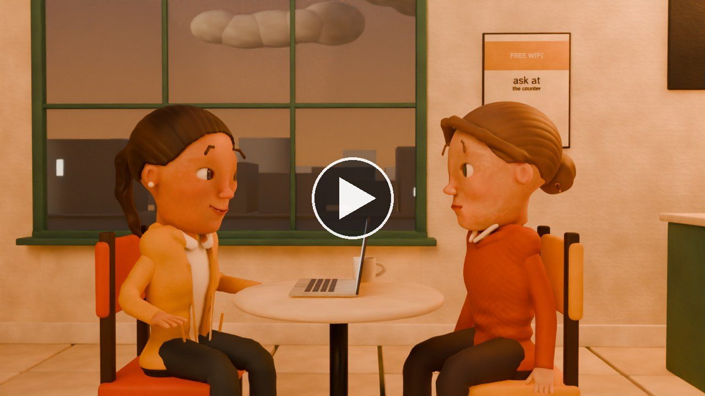
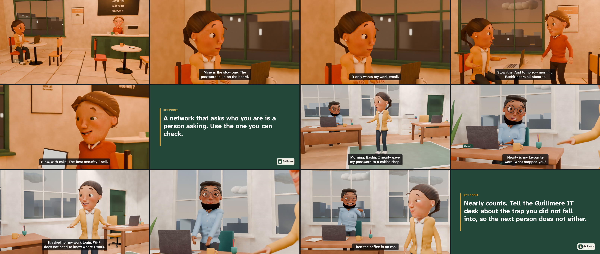
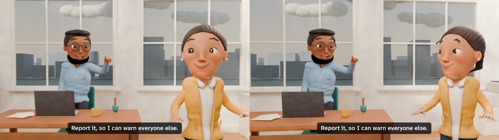
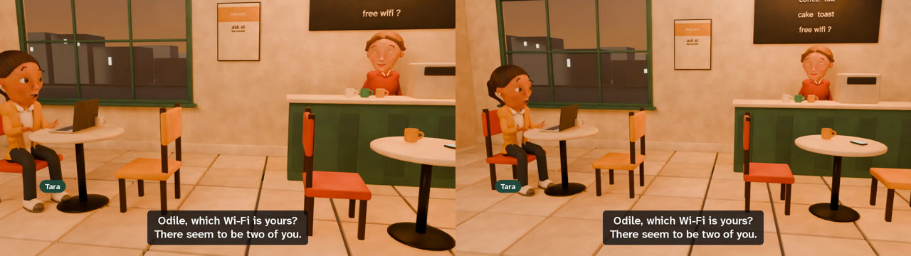
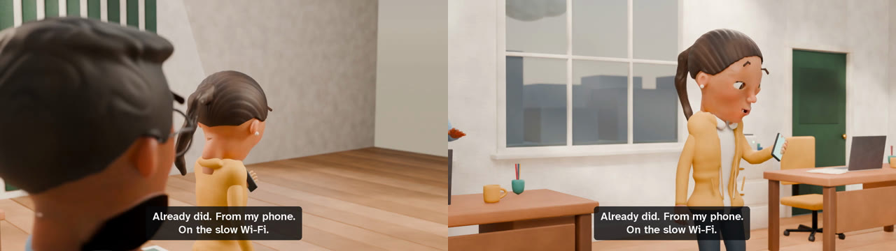
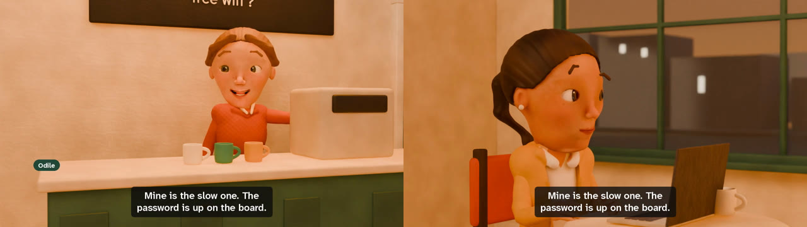
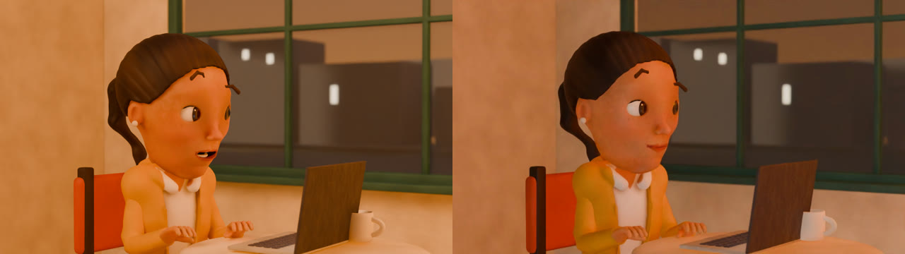
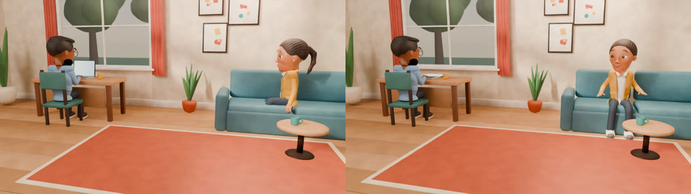
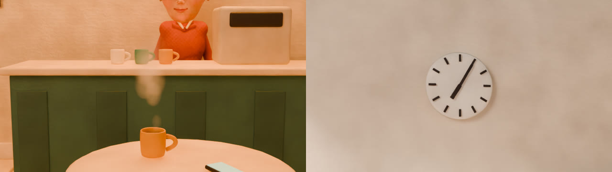

# Showcase: the sample film, and what each fix looks like

Everything here was rendered by the code in this repository, from
[`examples/the-fast-one`](../examples/the-fast-one/): two scene files and one page of character
descriptions.

## The film

**[Watch The Fast One](https://cdn.jsdelivr.net/gh/xIBBAx/clayvoyant@8cb3c0a/docs/media/the-fast-one.mp4)** (82 seconds, 6.6 MB; it plays in the browser, with the subtitles in
the picture. The file itself is [`docs/media/the-fast-one.mp4`](media/the-fast-one.mp4); GitHub's own
file page will not play a file this size). Made with
`sastudio film examples/the-fast-one --preset preview`: 1280x720, 24 frames a second, 1,974 frames,
seventeen filmed shots, thirteen lines voiced by Kokoro, -16 LUFS. Filming every shot from nothing
took 55 minutes on a laptop GeForce GTX 1660 Ti (measured on 11 November, before the solid-contact
re-film, which shared the machine with a second film). [TESTING.md](TESTING.md) lists what was checked.

## Before and after

Each pair is two real renders of the same moment: before a fix on the left, after it on the right.

**People turn to the person they talk to.** Every standing spot on a set used to pin a body to the
lens, so Tara faced the camera while Bashir talked to her.

**Everyone a shot is on stays inside the frame.** The framing measured the people's spread at the aim
point, so the speaker nearest the lens lost half her face to perspective. Now every head is projected
through the real lens.

**No shot shows the back of a speaker's head.** An over-the-shoulder placed behind a listener who
stands upstage saw the speaker from behind; it is now filmed from the front.

**A long line cuts to the listener between two words**, on a drawing where the speaker's mouth rests.

## Asked for in a scene file

**`direction.light`**: a room's own light. The preset on the left; a low, warm key from camera right
on the right.

**`direction.props`**: Bashir's laptop, open as the shot starts, closes as Tara arrives.

**`direction.dressing: [steam]`** and **`direction.clock: "07:05"`**.

How to ask for each of these: [DIRECTION.md](DIRECTION.md).
